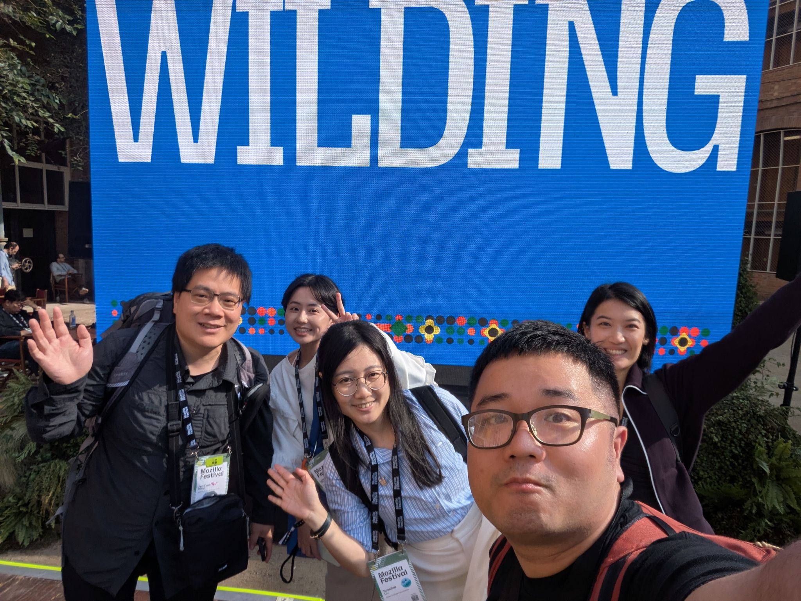
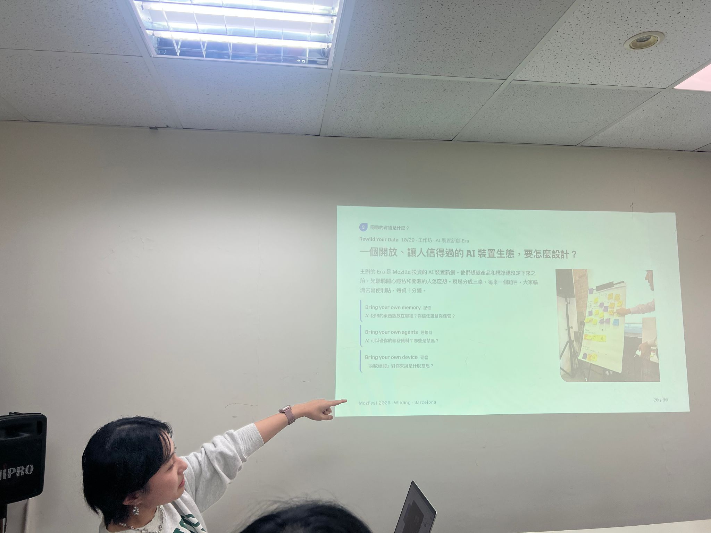
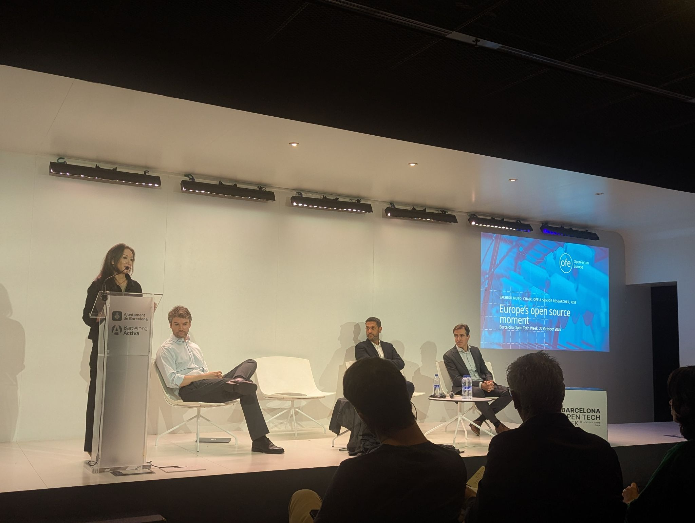
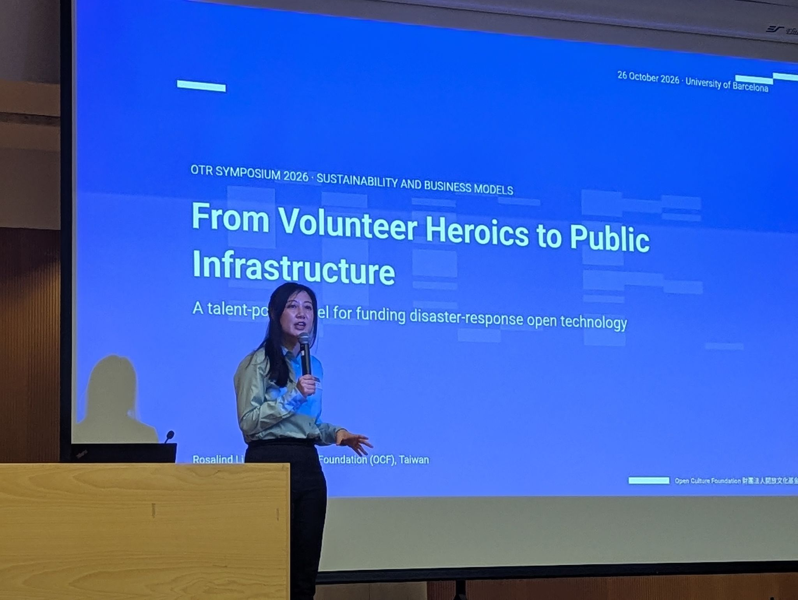
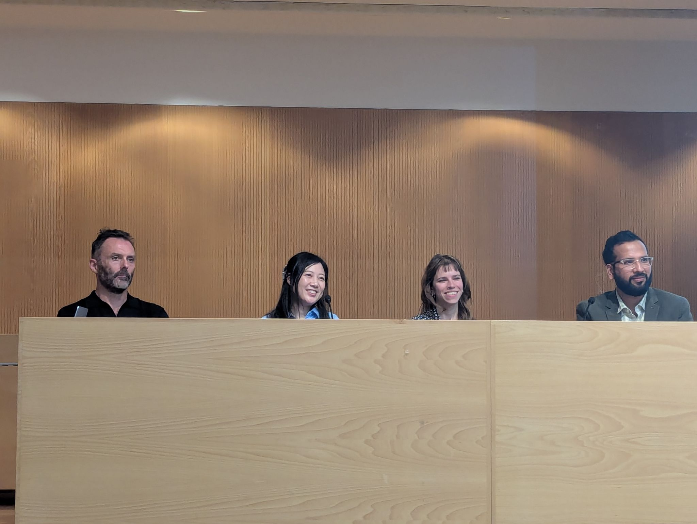
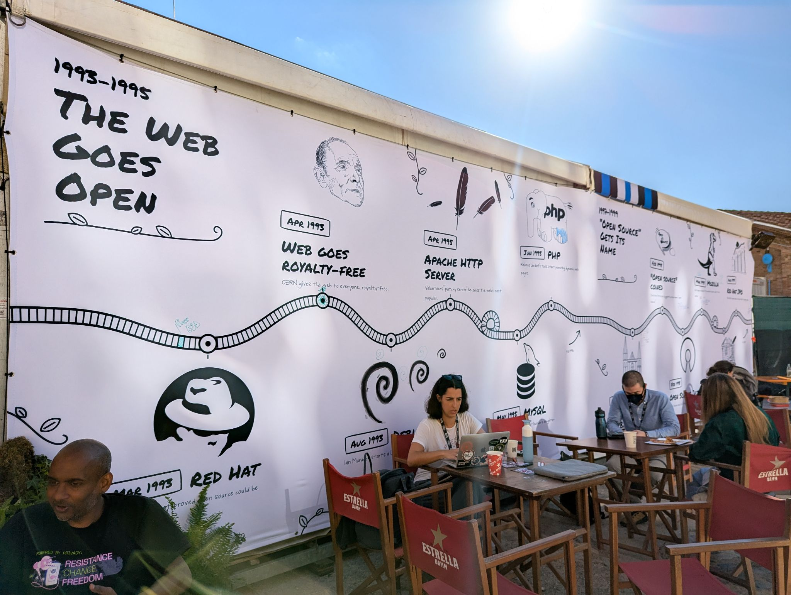
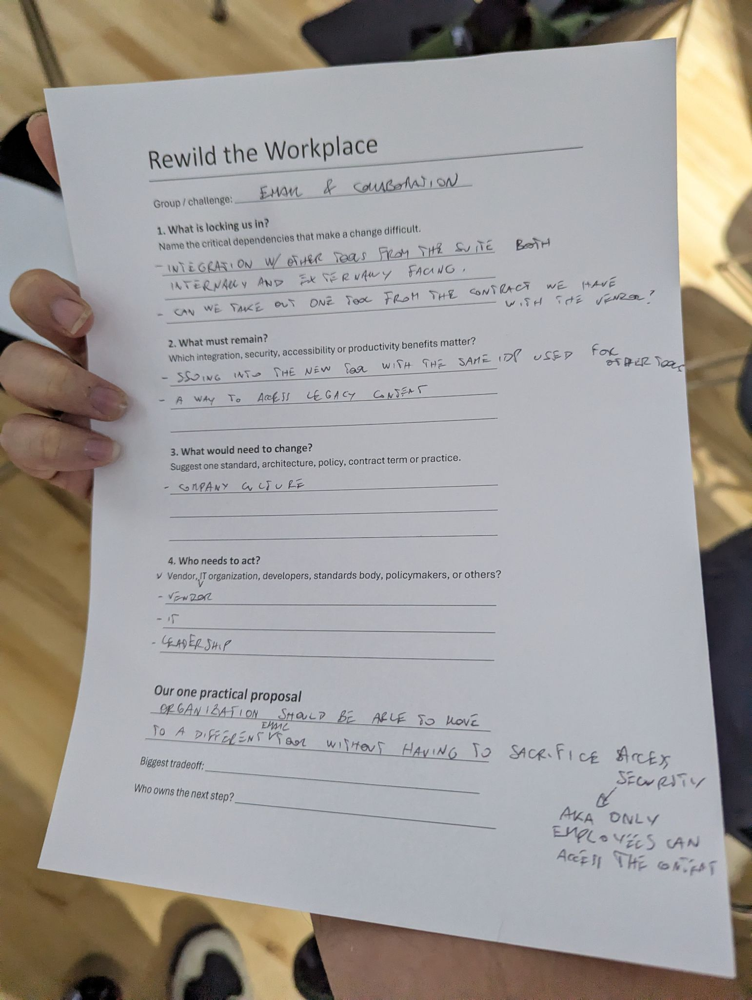
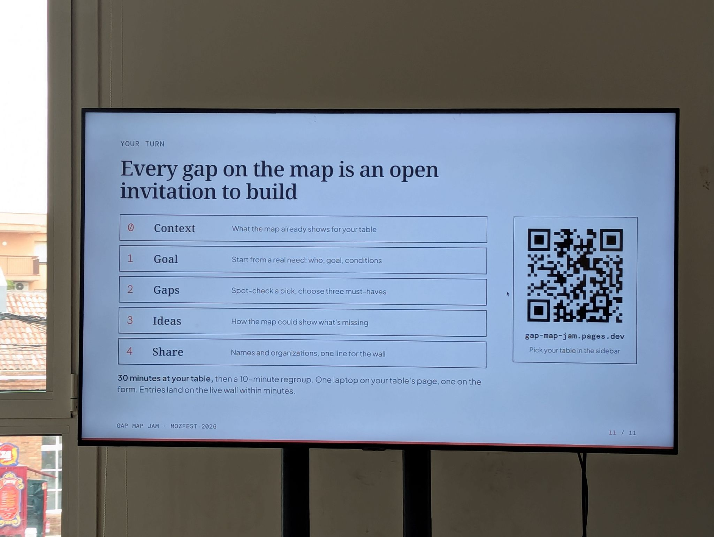
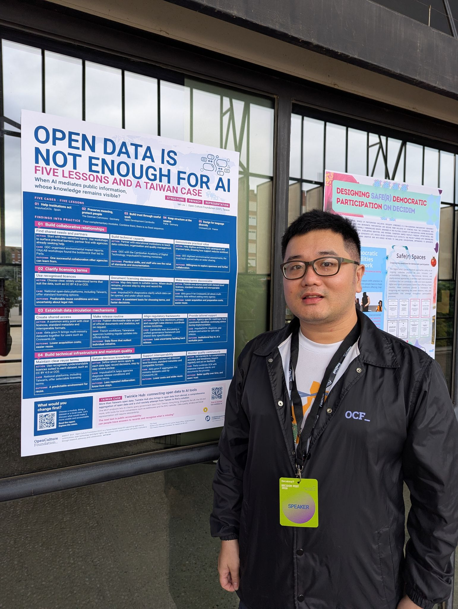

# 從巴塞隆納到台北，誰能決定科技怎麼用？｜11 月網路自由小聚紀錄

*來自台灣的參與者在巴塞隆納 MozFest 會場合影。*

當 AI 可以模仿已故親人的聲音，誰能決定要不要讓它開口？如果一個政府想降低對特定廠商的依賴，這會讓它有更多合作選擇，還是給跨國合作添一道門檻？

11 月 19 日，開放文化基金會（OCF）與 MozTW 在台北摩茲工寮舉辦網路自由小聚，分享十月底參與巴塞隆納開放科技週（Barcelona Open Tech Week）的觀察。這晚的話題從 Mozilla Festival（MozFest）的 AI 與同意設計，轉到歐洲的數位主權之辯，再回到台灣的救災工具、公共採購和語言資料。兩輪問答也討論了數位自主與跨國合作之間的關係，以及人們如何真正擁有使用科技的選擇。

本文依循 [Chatham House Rule](https://www.chathamhouse.org/about-us/chatham-house-rule)，以議題整理現場分享與問答，保護與會者的身分、所屬組織及發言歸屬。

開場先預告 12 月 5 日在立法院舉辦的國會工具交流。原先構想是辦黑客松，後來改為兩個交流場次，讓國會工作者與社群交換工具經驗，也談立法院實務上使用 AI 遇到的瓶頸。接著，分享轉向巴塞隆納開放科技週。這項為期一週的活動包含 MozFest 等多場聚會。第一段分享從設計工作出發，也簡介了台灣科技與設計社群如何在技術交流之外，留時間給職場經驗和問答。

## MozFest 的 Wilding，科技可以長出多少種樣子？

今年的 MozFest 在巴塞隆納一座由紡織工廠改造的文化空間舉辦，以 *Wilding* 為題。小聚從日常經驗聊起：當許多人透過相同的幾個平台找資訊、使用同一批語言模型寫作，本來因地而異的語言和文化，有多少還會留在工具裡？網路上原本就少見的語言，進到以網路資料訓練的模型時，也更難受到同等支持。

分享提到，會場讓人想起台北的松菸或華山。主舞台有字幕和手語翻譯，議程從人權、工程和設計延伸到藝術。有場黏土工作坊就請大家做一件「未來考古學家會挖到的數位文物」，有人捏了隻迷因蝦。科技如何改變生活，也可以從一個網路迷因談起。

分享者以三個面向討論科技的多樣性：**參與性**關乎受影響的社群能否參與設計和決策；**互通性**關乎資料和工具能否跨系統運作；**可追溯性**則關乎能否查明訓練資料的來源，以及系統作決定的條件。

### 當 AI 替我們最佳化，還有空間形成自己的想法嗎？

從咖啡店的裝潢到網頁版型，當愈來愈多人用相似的工具找靈感，產出也可能愈來愈像。小聚談到，如果每件事都先讓 AI 提出草稿，我們還會不會先問自己想做什麼、憑什麼接受它的建議？能比較、質疑和解讀得到的資訊，也是形成想法的一部分。

另一場工作坊以鳥群互相觀察、調整方向的方式作為設計靈感，探索音樂串流平台能否讓小群體透過身邊的人發現音樂。推薦不再完全由平台集中決定，結果或許能反映更多不同的品味。

### 誰有權決定自己的語言與文化怎麼被呈現？

當一個語言在網路上的內容很少，使用那個語言的人也更難在模型中被看見。以保存語言為由蒐集資料時，還得問資料交給誰、社群能不能修改或決定後續用途，以及資料進了產品後，原本提供素材的人能獲得什麼。稍後的討論也談到台灣的族語資料。

以黑人女性經驗為中心的 AI 治理工作坊，則質疑研究計畫的常見做法：計畫想了解技術對特定社群造成的傷害，受影響的人卻可能連研究問題怎麼設定都無法參與。工作坊主張讓社群從一開始就能決定要研究什麼、怎麼描述自己的技術經驗。

## 一個人按下同意，誰的資料也被交出去了？

小聚接著談到 MozFest 的集體隱私議題，並借《魔法少女小圓》的契約來問，按下同意的當下，使用者能知道自己答應了什麼嗎？一張照片可能同時拍到家人、鄰居或社群成員。應用程式把照片、訊息和行事曆放在一起分析，還可能從中推測健康狀況、移民身分或政治立場。按下同意的是一個人，受到影響的可能是一群人。放到毛利社群討論資料如何管理的經驗來看，還要問誰有資格代表集體，以及社群本身怎麼作決定。

另一個案例是在 MozFest 分享的語音合成故事。一位漸凍症患者過世後，家人希望用她的合成聲音念故事給孫子聽。當事人生前是否同意這個用途？如果後來想讓這個聲音讀她的日記，誰能替她作決定？有一種看法主張，死後的資料有自己的倫理地位，可以參考對待遺體的方式來思考，不能直接沿用一般財產的繼承和轉讓規則。這個例子提醒大家，同意涉及不同用途，也可能隨時間產生新的問題。

### 說「不要」也需要設計

MozFest 的 *Rewild Your Data* 工作坊討論了 AI 的記憶、連接器和硬體。連接器是讓 AI 讀取信箱、文件或行事曆等服務的介面。當工具接得愈多，人還能不能看出它記住了什麼、哪些服務正在交換資料？討論也問到，人能不能刪除記憶、撤回授權，或在關掉某項功能後繼續使用工具。未經同意就讓服務互傳資料，或拿個人記憶去訓練數位分身，都是具體的拒用條件。授權也要用不同年齡的使用者都看得懂的語言寫清楚。

*台北小聚分享 MozFest 工作坊對 AI 裝置、資料與同意的討論。*

分享也介紹了兩種做法。一種是活動現場的「No Photo」識別帶，讓人能直接表達不願入鏡。另一種來自公開議程的人權文件資料庫 Bayanat。團隊需要辨識阿拉伯文文件，又要讓敏感資料留在組織自己能掌握的設備上，於是使用可在一般電腦執行的文字辨識工具，留出人工核對的空間。無論是拒絕被拍攝，或選擇資料存放的位置，這些例子呈現了如何讓人實際行使選擇權。

分享還帶回一本做成野外圖鑑的手冊，收錄誤導和操弄使用者的介面設計（dark patterns），例如看起來像關閉鍵、點下去卻開了廣告的按鈕，或系統跳過使用者設定，硬把連結開在自己的瀏覽器。工作坊甚至有人提出，AI 設計者能不能像醫師一樣，說清楚自己願意遵守的倫理承諾。小聚也談到 MozFest 的氣氛：許多場次把時間留給參與者交換經驗，讓還沒有結論的問題可以繼續談。

## 第一輪問答｜歐洲先談監管，還做得出自己的 AI 嗎？

中場有人提到科技業對歐洲的批評，認為歐洲把力氣花在監管，卻沒有同樣快地發展自己的 AI。在巴塞隆納的會議上，有沒有聽到歐洲如何回應？

分享者以參與的活動為例：MozFest 讓設計、藝術、科技和數位人權社群一起討論技術的影響，因此很多場次把問題放在使用者能不能選擇、誰能接受或拒絕。談到歐洲的數位自主時，現場提到國際刑事法院（ICC）檢察官受美國制裁後，媒體報導他的電子郵件帳號受到影響。微軟否認封鎖該帳號。小聚借這個爭議追問，以 Microsoft 365 這類雲端服務辦公的機構，如果突然失去存取能力，手上有沒有備案？[美聯社報導](https://apnews.com/article/a4b4c02751ab84c09718b1b95cbd5db3) · [英國國會書面答覆](https://questions-statements.parliament.uk/written-questions/detail/2025-06-25/HL8821/)

分享者認為，保障權利與投入可維護、可替換的開源基礎設施，可以同時進行。現場有一種看法是，美國的科技產業較常由市場和資本帶動，中國的政策有較強的國家管制色彩，歐洲則想把人權、制度規範和開源放在一起，走出自己的路線。

*巴塞隆納開放科技政策峰會討論歐洲的開放原始碼政策與數位主權。*

## 開放科技週全貌｜從公民社群走到研究與政策

後半場介紹了整週活動的背景。2026 年 10 月 26 至 30 日是第二屆巴塞隆納開放科技週，開放科技研究研討會、MozFest 與 Decidim Fest 是當晚介紹的三個主要活動。據現場分享的盤點，至少有 11 位來自台灣的參與者，包括公開議程的講者、海報展示者和共同策展人。小聚也拿同城的行動通訊產業大展 MWC 作對照，說明開放科技週如何從巴塞隆納的在地社群、公民參與和文化場域出發。

開放科技研究研討會（OTR Symposium）由 OpenForum Europe、Open Knowledge Foundation、Open Source Initiative 和 Digital Infrastructure Insights Fund 共同召集。四個組織分別帶來開源政策、開放資料、開源授權與數位基礎設施研究的視角。從機關怎麼選用工具，到專案有沒有人長期維護，研討會關心的是能蒐集什麼證據，讓政策和資助決定有所依據。[OTR 公開議程](https://opentechresearch.org/blog/the-otr-symposium-2026-shaping-the-open-transition-takes-place-in-one-week/)

### 從花蓮光復到丹娜絲，救災科技能不能留到下一次？

研討會分享了兩個台灣案例。花蓮光復堰塞湖溢流後，民間社群迅速用線上工具整理資訊，媒合投入救災的志工和在地需求。丹娜絲颱風過後，也有志工製作地圖，協助掌握含石綿建材廢棄物的分布。小聚也提到，政府想支持臨時動員的團隊時，公款怎麼支付、怎麼符合防弊要求，往往要到現場才發現沒有現成的做法。

*開放科技研究研討會的公開發表介紹如何支持救災公民科技。*

分享提到三項仍在研議的做法。第一，平時建立技術協作者名單，先談好資格、報酬和保險。第二，透過正式協議，讓協作者在災時知道如何接上既有的應變團隊。第三，由公共資源支持可重複使用的軟體元件，平時持續維護，也安排資安檢視。這些安排會影響下一次應變時找不找得到人，以及另一批志工有沒有辦法接手資料和工具。

*開放科技研究研討會的與談現場。*

同場有關開源資助的研究，也提供了看成效的方式。除了看災時做出幾個工具，還可以看專案過後的文件是否有人整理、能不能順利交接，以及幾個團隊有沒有可能共用一套元件。現場也帶到 OCF 參與的台灣公部門開源應用指引工作，希望機關在採用或採購軟體時，就把授權、維護及交接條件想清楚。

### 開放硬體要接上設計與製造

小聚談到開放硬體時，這些問題又往上游延伸。就算電路設計可以取得，還要看有沒有團隊能用開放的電子設計工具（Open EDA）檢視或修改它，以及有沒有製造、測試和後續維修的能力。討論以台積電在德勒斯登和熊本的設廠布局為例，指出軟體與硬體的依賴分布在不同地方。在地製造能力增加之後，各地應該如何繼續合作，也成為接下來的討論焦點。

## 第二輪問答｜數位自主會變成另一種排他嗎？

接著有人挑戰，如果歐洲用政策支持自己的開源硬體與供應鏈，會不會以自主之名，把跨國合作變得更困難？現場用晶片供應鏈的分工作對照。歐洲有 ASML 等關鍵設備供應商，亞洲也有重要的製造能力。如果每個地方一面要求降低依賴，一面希望其他地方繼續採用自己的技術，怎麼知道這項政策是在增加韌性，還是在保護特定市場？

回應把焦點放在依賴出問題時有沒有調整空間。共同使用開放的設計、標準或程式碼，可以讓不同地方繼續分工。遇到供應中斷或服務條件改變時，參與者也有機會找其他團隊接手。外部依賴過高會讓人缺乏選擇，而自主政策的條件如何訂、誰有資格參與，也會決定它究竟帶來更多協作，還是讓合作範圍更窄。

討論也回到公部門使用開源程式碼時的具體問題。Software Heritage 的公開原始碼典藏，讓研究者能追蹤程式碼從哪裡來、怎麼流通，以及 AI 訓練用到的程式碼能不能追溯來源。當程式碼已能在網路上取得，授權是否清楚，仍會影響別人能不能合法使用或修改。這些條件同樣關係到公部門要怎麼採用和交接。[Software Heritage 的 OTR 議程](https://symposium.opentechresearch.org/)

## 把自己的社群寫進開源歷史

問答後，分享回到 MozFest 的主舞台和工作坊。開幕用了從牆縫長出花的意象，談科技的多樣性。一旁的開源歷史布牆則畫出不同技術和社群的時間軸，留了畫筆讓參與者填上自己的里程碑。從 Creative Commons 到台灣的開源社群，平常較少出現在正式紀錄裡的經驗，也能加到這面牆上。

*MozFest 的開源歷史布牆，邀請參與者補上社群的里程碑。*

## 換了工具，資料和工作還能接續嗎？

小聚後段回到 MozFest 的辦公工具工作坊。一場 Firefox Enterprise 相關分享，用選擇、互通、資料可攜、透明和參與決定來看什麼叫作「開放」。工作坊則從日常情境出發：電子郵件、文件、身分驗證和裝置管理如果一起採用同一套服務，替換其中一項時，其他環節還能不能照常運作？

*MozFest 的辦公工具工作坊整理團隊面對的依賴，以及更換工具時必須保留的工作條件。*

討論也以 openDesk 這類開源辦公套件為例：工具換了，如果資料格式仍難互通、替代服務商無法維護，依賴可能只是移轉。在台灣公部門採購的情境裡，可以在合約還沒簽前就問清楚資料如何取回、管理權限由誰掌握、文件能否支援交接。對第一線的公民組織來說，還要考慮連線不穩或資料敏感時，替代工具是否真的能用。

## 開放 AI 缺什麼，誰決定怎麼補？

另一場 MozFest 工作坊展示 Current AI 的 Gap Map。它把開源 AI 生態中的模型、元件與基礎設施整理成地圖，讓使用者從自己的需求出發找出缺口。例如工具能不能處理某個語種的語音？現有資料的品質如何？就算找得到模型，組織有沒有設備或人力把它用起來？

*Gap Map 工作坊請參與者從一項實際需求出發，找出開源 AI 工具還缺少哪些環節。*

語言資料則是與台灣息息相關的例子。討論以英語、簡體中文和法語作對照，談不同語種在開源 AI 生態中能取得的資源差距，也提到台灣透過 Mozilla Common Voice 建立原住民族語的開放語音資料，泰雅族語便是其中之一。要讓模型支援更多語言，還得談誰來蒐集和維護，標註時能否保留語音與文化脈絡，以及社群能否參與決定資料用於教學、模型訓練或商業服務的條件。[Common Voice 原住民族語錄音計畫](https://moztw.org/common-voice/)

## Decidim Fest｜公民提出意見後，事情怎麼往下走？

最後，分享帶到以「多極世界中的民主與科技」為題的 Decidim Fest。台灣帶去的公開案例包括亞洲政府如何設定開源政策，以及 OCF 用 Twinkle Hub 等案例討論 AI 要能使用公共資料所需的條件。把資料放上網後，格式能不能被電腦讀取、應該公開到什麼程度、語言與文化能不能被適當呈現，仍然需要一一處理。

*Decidim Fest 的公開海報分享 AI 時代的公共資料需求，以及來自台灣的案例。*

Decidim 是從巴塞隆納長出的開源參與平台，當地用它支持居民提案和參與式預算。公開議程中也有台灣研究者分享，公民社群如何與公共機構協作。這些案例也帶出一個問題：居民提案送出之後，能不能知道機關怎麼處理、採納或不採納的理由是什麼，以及後續由誰追蹤？從台灣災後社群接上公部門的工作，到居民意見接上公共決策，參與能不能延續，取決於有沒有清楚的回應和交接方式。

### 地緣政治下的數位自主，以及外界怎麼看台灣

這一段也討論了烏俄戰爭。當公共服務依賴跨國的雲端和供應鏈，衝突可能影響系統能否持續使用。現場也談到，開源讓不同國家可以共享成果，標準的治理仍可能受到具備較多資源的政府或企業影響。誰能參與訂標準、遇到爭議時有哪些制衡方式，因而成了民主與科技議程的一部分。

小聚也回顧在國際場合談台灣的經驗。數位政府和公民科技讓台灣在國際間受到關注，但國際夥伴的印象，與台灣團隊日常面對的資料品質、基礎建設及跨機關協作問題仍有距離。這場小聚同時分享了成果與挑戰，也讓大家看見三個活動各自關注的議題：開放科技的制度支持、使用者的參與和拒絕權，以及居民如何參與公共決策。

## 直播重播與延伸閱讀

小聚最後預告下一場交流暫訂 12 月 17 日，活動資訊以社群公告為準。如果錯過這一晚，歡迎[觀看 11 月網路自由小聚直播重播](https://www.youtube.com/watch?v=UHhztJ74mUo&t=8s)。關心數位人權、網路隱私和開放科技的朋友，也可以加入[網路自由小聚線上討論區](https://groups.google.com/g/coffee-circumvention-tw)，掌握下一場小聚的消息。

- [本場活動頁](https://ocftw.kktix.cc/events/internetfreedom-nov2026)
- [Mozilla Festival 2026｜Wilding](https://www.mozillafoundation.org/en/festival/theme/)
- [MozFest 的公開出訪紀錄｜Mozilla Festival 闖蕩紀實](https://medium.com/@wu0h9625/mozilla-festival-%E9%97%96%E8%95%A9%E7%B4%80%E5%AF%A6-e3203edb3aa6)
- [OTR Symposium｜開放科技研究研討會議程](https://opentechresearch.org/blog/the-otr-symposium-2026-shaping-the-open-transition-takes-place-in-one-week/)
- [Current AI｜開源 AI 生態系缺口地圖](https://www.aipotluck.org/map)
- [Decidim｜開放原始碼公共參與平台](https://decidim.org/)
