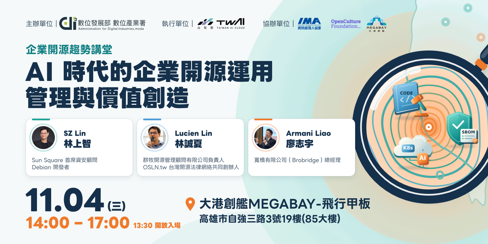
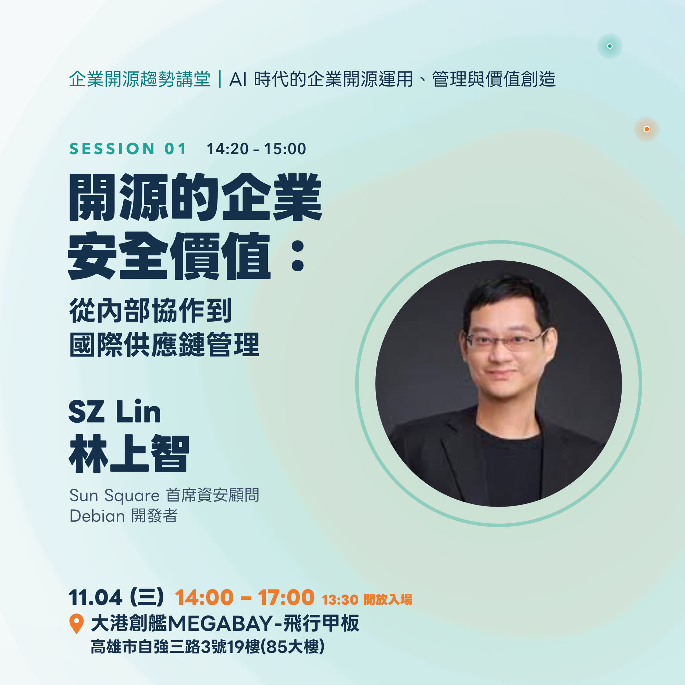
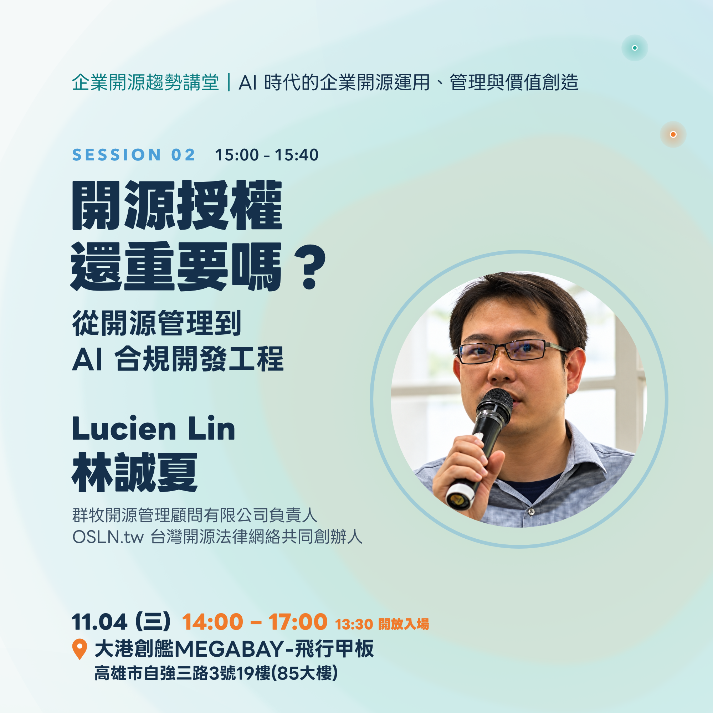
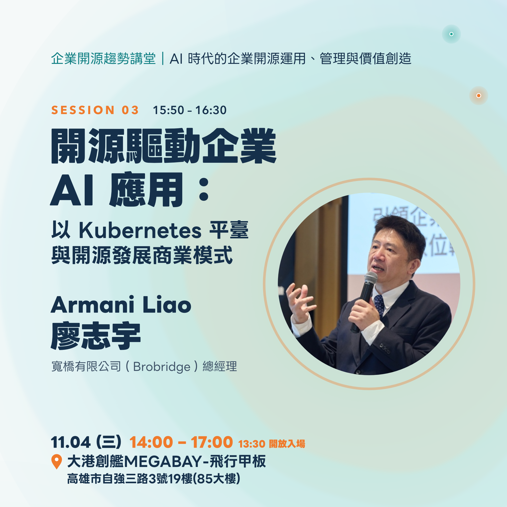
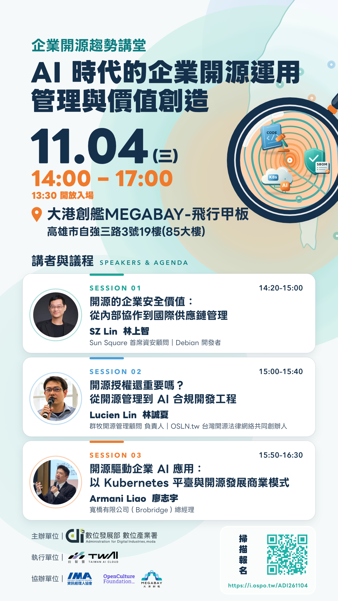

# 企業開源趨勢講堂：AI 時代的企業開源運用、管理與價值創造

撰文編輯／Ian Liu (Yanyiyi)

當 AI 加速軟體開發與應用導入，開放原始碼也更深入企業的產品、系統與服務。企業除了選擇合適的技術，也需要面對內部協作、授權合規、軟體供應鏈安全與技術治理等共通課題，並思考如何將開源能力落實到產品與服務。

為協助企業掌握開源運用與管理的實務方向，數位發展部數位產業署辦理本次活動，邀請三位分別投入企業開源與工業資安、開源授權管理，以及開源應用與商業實務的講者，從企業安全、AI 開發授權到商業應用出發，透過實務經驗協助南部企業理解開源的運用、管理與價值創造，找到適合自身組織的下一步。

歡迎企業主與主管、資服業者、製造業與設備商的資訊及研發團隊，以及資安、法務、採購與專案管理工作者一同參與。

<a class="ui primary button" href="https://i.ospo.tw/ADI261104">立即報名企業開源趨勢講堂</a>

## 活動資訊

* 日期：2026 年 11 月 4 日（三）
* 時間：14:00–17:00（13:30 開放入場）
* 地點：大港創艦 MEGABAY－飛行甲板
* 地址：高雄市自強三路 3 號 19 樓（85 大樓）
* 主持人：Singing 李欣穎｜開放文化基金會（OCF）執行長
* 主辦單位：數位發展部數位產業署
* 執行單位：台灣智慧雲端服務股份有限公司
* 協辦單位：中華民國資訊經理人協會（IMA）、財團法人開放文化基金會（OCF）、大港創艦 MEGABAY
* 報名方式：[線上報名](https://i.ospo.tw/ADI261104)

## 議程

| 時間 | 議程 | 講者 |
| --- | --- | --- |
| 13:30 | 開放入場 | — |
| 14:20–15:00 | 開源的企業安全價值：從內部協作到國際供應鏈管理 | SZ Lin 林上智 |
| 15:00–15:40 | 開源授權還重要嗎？從開源管理到 AI 合規開發工程 | Lucien Lin 林誠夏 |
| 15:50–16:30 | 開源驅動企業 AI 應用：以 Kubernetes 平臺與開源發展商業模式 | Armani Liao 廖志宇 |

活動時間為 14:00–17:00；上表列出海報已公告的講題時段，其他活動安排請以主辦單位最新公告為準。

## 講題一｜開源的企業安全價值：從內部協作到國際供應鏈管理

*開源元件成為企業產品與系統的基礎，安全管理也需要跨部門與供應鏈協作。本場分享推動開源辦公室與 InnerSource 的經驗，從元件使用與維護，談供應鏈攻擊風險與資安管理，並結合參與國際標準制定的經驗，說明開源協作如何支持供應鏈安全與企業合作。*

**時間：14:20–15:00**

**講者：SZ Lin 林上智｜Sun Square 首席資安顧問｜Debian 開發者**

開源軟體已經成為企業產品與系統的重要基礎。真正困難的往往不是能不能使用開源，而是元件由誰選擇、誰負責維護、版本如何更新，以及出現安全問題後，由誰判斷與處理。

本場將從實際推動企業開源辦公室（OSPO）與 InnerSource 的經驗出發，分享研發、資安與管理團隊如何建立共同的開源使用、貢獻與維護機制。當這些責任與協作方式逐漸建立後，企業才有能力持續掌握產品中的軟體元件、版本、來源與依賴關係。

從這裡再進一步討論 SBOM、漏洞處理與軟體供應鏈安全：企業如何把一次性的元件盤點，轉變成產品開發與維護流程的一部分，並在產品持續更新的情況下維持可追蹤性與處理能力。

最後，SZ 將結合國家標準與國際標準工作的經驗，分享當客戶、供應商、法規與標準開始要求軟體供應鏈證據時，企業如何把原本的內部開源治理能力，轉化為可以對外說明與驗證的產品安全能力。

### 講者 Bio

長期投入開放原始碼、嵌入式 Linux 與工業資安，為 Debian 開發者，曾參與工業級 Linux 平臺相關工作，並具企業開源辦公室（OSPO）建置及 InnerSource 推動經驗。

現任 Sun Square 首席資安顧問、經濟部標準檢驗局國家標準技術委員，長期參與開源軟體供應鏈、產品資安與工業資安相關標準工作，曾參與 OpenChain ISO/IEC 5230 開源授權合規與 ISO/IEC 18974 開源軟體安全保證等國際標準制定，並參與相關標準的中文翻譯；同時參與關鍵基礎設施與半導體資安相關國際標準及產業工作。

工作重點涵蓋企業開源治理、軟體供應鏈與產品資安，以及如何將標準與法規要求落實到實際產品開發與長期維護流程。

## 講題二｜開源授權還重要嗎？從開源管理到 AI 合規開發工程

*當 Vibe 與 Agent Coding 參與套件選用與開發，開源與授權還重要嗎？20 年來，開源專案逐步成為跨國廠商的協作基石，授權提供協作規則。AI 時代，企業需以此提升開發效率與產品優勢，並掌握開發品質。本場說明「開源作為商用智慧」的實務價值，與內部開發合規訓練所需的指導原則。*

**時間：15:00–15:40**

**講者：Lucien Lin 林誠夏｜群牧開源管理顧問有限公司負責人｜OSLN.tw 台灣開源法律網絡共同創辦人**

Vibe 與 Agent Coding 等 AI 協作模式，正改變企業取得、生成與修改程式碼的方式。許多與開源有關的問題與質疑陸續被提出，例如：有了 AI Coding 之後，能不能直接將現有開源套件改寫、另行實作？若此法可行，未來開源專案是否將漸漸無人加入，或呈現衰退趨勢？就整體產業趨勢而言，這些推測尚未成為普遍現象。然在資訊產業界，反而因應各國法規對責任要求的強化，開源軟體成為各領域開發基石的態勢已然形成。

從實務觀察來看，開源作為商用智慧（Open Source as Business Intelligence）在 AI 時代更顯重要。這是因為跨國資通訊產業的產品研發模式，多採用成熟或已建立生態聯盟共識的開源專案作為協作基石，以分擔開發、更新、資安維護等底盤工作，而後再於各自的差異化市場中發揮產品特性。在開源基石與產品優化之間，如何善用 AI Coding，並優化應用上的 Prompting Know-how，反而成為個別企業下一世代產品優勢的護城河。

本場次將以各類開源授權條款的基礎知識為主，包括 BSD 類別、GPL 類別與其他類別的差異，繼之以 Wine 的開發實務與淨室開發工程（Clean-room Engineering）概念為輔，說明在 AI 時代的開源應用中，如何在協作基礎上辨識可行的商業模式，並於產業開發流程裡導入 AI 合規工程（AI Compliance Engineering）的實作概念與指導，以在尊重開源專案授權規則的前提下，同步優化個別企業應用上的優勢。

### 講者 Bio

科技法律背景，曾於中央研究院自由軟體鑄造場（OSSF）研究公眾授權模式，並參與《政府資料開放授權條款》、《臺灣主權 AI 訓練語料授權條款》的研擬與推廣。長期協助企業與社群釐清開源授權、CC 授權、智慧財產權及合規管理問題，近年亦關注生成式 AI 的共益推動與使用倫理。現為群牧開源管理顧問有限公司負責人、OSLN.tw 台灣開源法律網絡共同創辦人，善於透過輔導，將開源協作管理落實於實際開發與交付流程。

## 講題三｜開源驅動企業 AI 應用：以 Kubernetes 平臺與開源發展商業模式

*企業 AI 應用從試作走向上線，需要考量系統整合、部署與長期維運。本場分享以 Kubernetes 等開源技術發展 AI 應用的經驗，說明如何將技術轉化為客戶需要的產品與服務，並從顧問、導入到維運，探討開源商業模式的收益來源與長期經營。*

**時間：15:50–16:30**

**講者：Armani Liao 廖志宇｜Brobridge 寬橋有限公司總經理**

企業導入 AI，需要讓新技術接上既有系統、資料與工作流程，也需要安排部署、更新與長期維運。對資服業者而言，如何理解客戶需求、選擇合適的開源技術，並提供持續支援，是從技術應用走向商業經營的重要課題。

本場將分享以 Kubernetes 等開源技術發展企業 AI 應用的經驗，說明如何將技術能力轉化為客戶需要的產品與服務。從企業資料整合與應用需求出發，探討開源技術如何支撐解決方案，並在實際服務中創造價值。

Armani 也將從企業經營角度，分享開源與商業模式的結合，從顧問、導入到維運，談收益來源與長期經營的實務，讓參與者看見開源投入如何形成持續發展的事業。

### 講者 Bio

現為寬橋有限公司（Brobridge）總經理，帶領團隊投入 Kubernetes、微服務與企業資料整合，發展支援企業 AI 應用的平臺與服務。關注如何讓既有系統與資料成為 AI 可運用的資源，並從企業經營角度，將技術能力轉化為客戶需要的產品、顧問與導入服務，連結開源應用與商業價值。

## 講者與主持人

  

    

      

    

    

      
SZ Lin 林上智

      
Sun Square 首席資安顧問｜Debian 開發者

      
長期投入開放原始碼、嵌入式 Linux 與工業資安，具企業開源辦公室（OSPO）建置及 InnerSource 推動經驗。現為經濟部標準檢驗局國家標準技術委員，參與 OpenChain 等國際標準工作，關注如何將開源治理、軟體供應鏈與產品資安落實於開發及長期維護流程。

    

  

  

    

      

    

    

      
Lucien Lin 林誠夏

      
群牧開源管理顧問有限公司負責人｜OSLN.tw 台灣開源法律網絡共同創辦人

      
科技法律背景，曾於中央研究院自由軟體鑄造場（OSSF）研究公眾授權模式，參與政府資料開放與 AI 訓練語料授權條款的研擬及推廣。長期協助企業與社群釐清開源授權、智慧財產權及合規管理，將開源協作管理落實於實際開發與交付流程。

    

  

  

    

      

    

    

      
Armani Liao 廖志宇

      
Brobridge 寬橋有限公司總經理

      
帶領團隊投入 Kubernetes、微服務與企業資料整合，發展支援企業 AI 應用的平臺與服務。關注如何讓既有系統與資料成為 AI 可運用的資源，並從企業經營角度，將技術能力轉化為客戶需要的產品、顧問與導入服務，連結開源應用與商業價值。

    

  

  

    
  

  

    
Singing 李欣穎

    
主持人｜開放文化基金會（OCF）執行長

    
喜好自由與分享的文化，自 2009 年起參與 COSCUP 與 MozTW，並曾擔任 COSCUP、HITCON、MOPCON、OSDC 等技術社群研討會志工。2015 年加入 OCF，持續與社群夥伴一起為開放文化貢獻心力。

  

## 活動海報與報名

<a class="ui primary button" href="https://i.ospo.tw/ADI261104">立即報名｜11 月 4 日高雄見</a>

## 開源治理系列專文

* [#01 OCF 正式加入 OSPO 聯盟！開源治理手冊是什麼？](https://ocf.tw/story/ospos-1-join-OSPO-alliance/)
* [#02 OSPO 正在集結中！來自世界各地的政府開源專案辦公室](https://ocf.tw/story/ospos-2-floss-pso-intl-network/)
* [#03 2026 Q1 開源合規與安全調查報告：臺灣企業準備好了嗎？](https://ocf.tw/story/ospos-3-taiwan-open-compliance-security-report-2026-q1/)
* [#04 開源不只是技術選擇：AI 時代企業布局國際競爭力的起點](https://ocf.tw/story/open-source-business-ai-competitiveness-2026/)
* [#05 OCF 前進 Sony 總部：臺灣開源治理推動經驗如何與亞洲接軌？](https://ocf.tw/story/ospos-5-ospology-asia-sony-2026/)
* [#06 串連社群、產業和政府：OCF 在 OSPOlogy Asia 2026 的分享紀實](https://ocf.tw/story/ospos-6-start-before-formal-ospo/)
* [#07 AI 時代的企業開源備忘錄：亞洲協作趨勢、歐盟供應鏈規範到 17 年實戰](https://ocf.tw/story/ospos-7-enterprise-open-source-memo-2026/)
* [#08 從「和」到一套能直接使用的文件：日本如何以 OSPO Starter Kit 支持產業](https://ocf.tw/story/ospos-8-japan-ospo-starter-kit/)
* [#09 讓麻瓜也看懂 SBOM：韓國 BomLens 如何從個人手上的風險介接到公司治理](https://ocf.tw/story/ospos-9-korea-bomlens/)
* [#10 企業開源趨勢講堂：AI 時代的企業開源運用、管理與價值創造](https://ocf.tw/story/ospos-10-enterprise-open-source-ai-2026/)
* [#11 企業用了開源之後：責任、技術依賴與社群回饋的現場對話](https://ocf.tw/story/ospos-11-enterprise-open-source-memo-recap-2026/)
