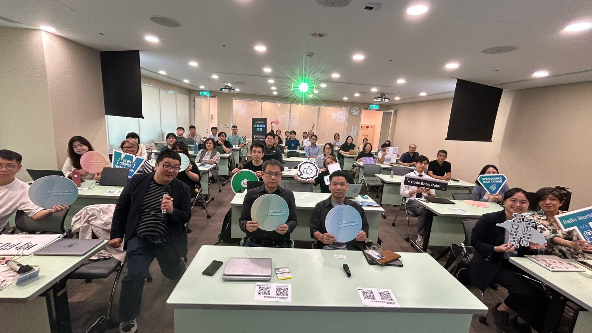
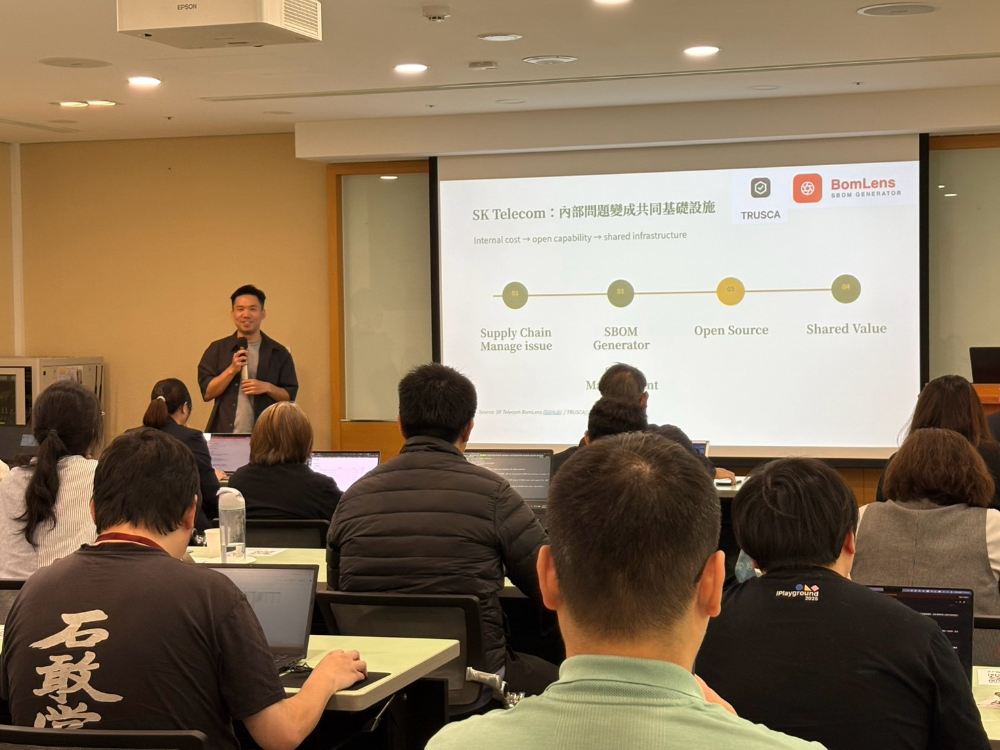
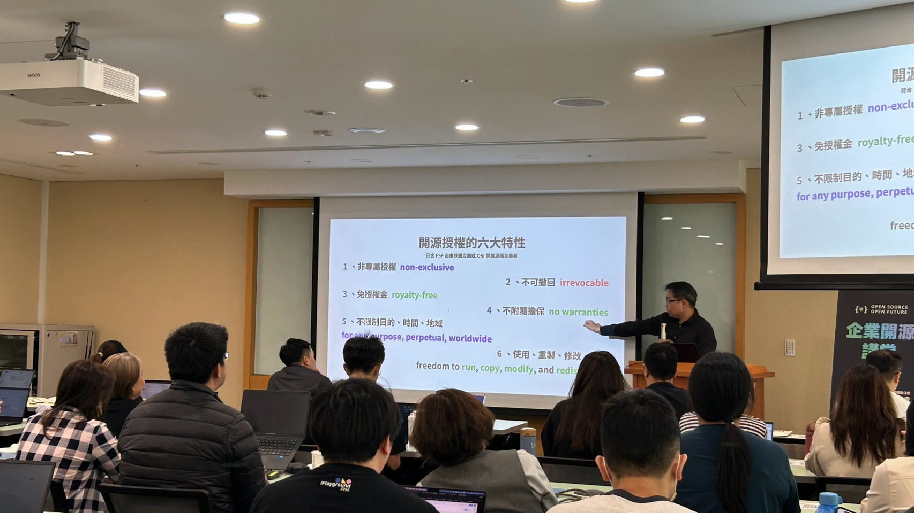
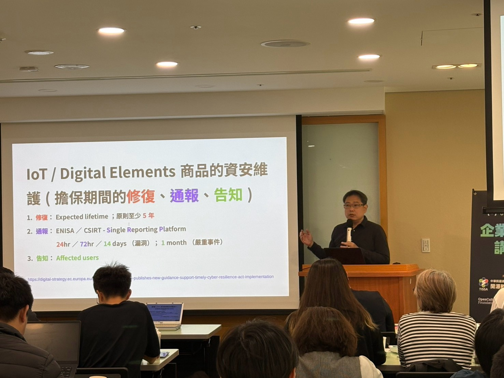
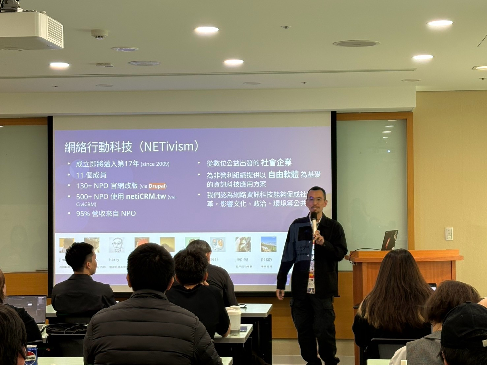
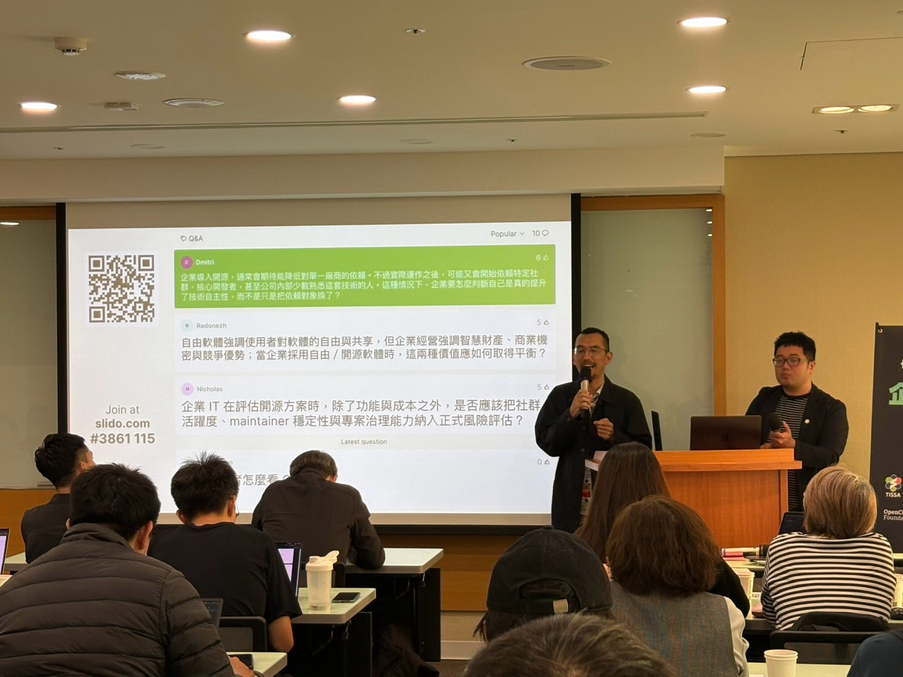

# 企業用了開源之後：責任、技術依賴與社群回饋的現場對話

**核心套件出了問題，誰來接手？取得原始碼，就有技術自主性嗎？從企業參與者的提問出發，整理 Ryan Hsieh、Lucien Lin 與 Jimmy Huang 對開源維護責任、上游回饋及 AI 協作文化的實務回應。**

撰文編輯／開放文化基金會（OCF）

9 月 23 日，由中華民國資訊軟體服務商業同業公會開源軟體生態促進會主辦，開放文化基金會（OCF）、開源基金會及 OpenChain 台灣工作小組協辦的[「AI 時代的企業開源備忘錄：亞洲協作趨勢、歐盟供應鏈規範到 17 年實戰」](https://i.ospo.tw/story-007)，在臺北張榮發基金會國際會議中心舉行。

這次交流延續 OCF 近年推動企業開源治理的工作，也將 7 月在東京 OSPOlogy Asia 接觸到的亞洲企業案例，與臺灣的法規實務、企業經營經驗放在一起討論。

三位主要講者分別從亞洲企業的開源治理、歐盟《網路韌性法案》（Cyber Resilience Act，CRA），以及臺灣開源企業長期經營的角度切入。除了分享各自的經驗，現場參與者也提出了不少問題：企業使用開源軟體後，應該負擔多少回饋責任？修改上游套件後要如何追蹤來源？使用開源真的能降低技術依賴嗎？AI 又會如何改變原本的開源協作方式？

這篇文章整理幾個當天的分享重點，以及現場值得繼續討論的問題。

***9 月 23 日，講者與參與者齊聚臺北，交流亞洲企業開源治理、歐盟 CRA 與臺灣開源企業的經營經驗。***

## 企業不只要管理開源軟體，也需要理解背後的協作關係

第一場由 Ryan Hsieh 謝文豪分享亞洲企業的開源治理趨勢。Ryan 參與今年 OSPOlogy Asia 的籌備與議程規劃，也有在臺灣金融業推動企業 OSPO（Open Source Program Office，開源計畫辦公室）的實務經驗。

Ryan 從企業的軟體供應鏈管理談起，提出一個實際情境：如果公司使用的核心開源專案停止維護，或是突然出現重大安全漏洞，應該由誰來處理？

與傳統軟體採購不同，開源專案不一定有固定的供應商或服務承諾。企業可以透過採購合約、服務水準協議（SLA）管理一般商業供應商，但對於由全球開發者共同維護的開源專案，則需要透過參與社群、理解專案運作方式，逐步累積影響力。

這也帶出 OSPO 在企業內部的角色。除了授權審查與開源合規，企業還需要讓工程、資安、法務及經營團隊建立共同的管理流程，並連結外部開源社群。

Ryan 以日本、韓國的企業經驗，說明不同組織如何處理共同面對的開源問題。

日本的 Automotive Grade Linux（AGL）與 Civil Infrastructure Platform（CIP），呈現了原本在市場競爭的企業，如何共同維護基礎軟體，減少彼此重複投入的開發及維護成本。

韓國 Samsung 則將開源治理融入人才、專案與日常流程，包含開源貢獻者的職涯發展，以及企業內部的審查與管理機制。SK Telecom 的例子則是將自身管理軟體供應鏈的需求，發展成可供其他組織使用的開源工具。

***Ryan 以 SK Telecom 為例，說明企業如何將內部的供應鏈管理需求，發展成能與其他組織共享的開源工具。***

這些案例與我們先前介紹的[日本 OSPO Starter Kit](https://i.ospo.tw/story-008)、[韓國 BomLens](https://i.ospo.tw/story-009) 相互呼應。前者將企業建立 OSPO 需要的政策與流程整理成可修改的文件，後者則從 SBOM 工具出發，讓企業與供應商更容易開始進行元件盤點與風險管理。

### 回饋開源社群，如何成為企業願意投入的工作？

現場有參與者問到，企業享受開源所帶來的自由與價值時，應該承擔多少回饋責任？當企業同時需要考量商業機密、智慧財產與競爭優勢，又該如何取得平衡？

Ryan 從企業經營的角度回應，如果開源並未被納入公司重視的經營目標，很難單純以公益回饋或永續議題取得長期投入的資源。

相較於只將貢獻視為捐款或公益活動，企業也需要思考，投入上游專案、培養開源人才或建立社群關係，能如何改善自身的產品、降低風險，或減少重複處理問題的成本。

另一個現場問題則是，如果公司想開始推動開源文化，應該從哪裡著手？

Ryan 提到日本 IPA 提供的 OSPO Starter Kit，以及 DevRel（Developer Relations，開發者關係）等做法，但具體如何設計，仍取決於企業想解決的問題。

這些交流也帶出一個值得注意的差異：企業使用開源的數量、參與活動的次數，未必能直接反映治理成效。公司是否更清楚自身依賴哪些專案、能否及早處理風險，以及是否有能力持續參與技術社群，都是不同階段需要衡量的面向。

## CRA 帶來的變化：企業要知道產品用了什麼，也要知道責任在哪裡

第二場由群牧開源管理顧問有限公司負責人、台灣開源法律網絡 OSLN.tw 共同創辦人 Lucien Lin 林誠夏，分享歐盟 CRA 對全球企業及開源社群的影響。

Lucien 先從開源授權的基本概念談起，再逐步說明 CRA 如何區分開源軟體的不同參與者，以及商業產品製造商需要負擔的責任。

***Lucien 從開源授權的基本特性談起，為後續討論商業產品與開源參與者的責任建立共同理解。***

對企業來說，重要的區別是：自由分享開源軟體的行為，與將開源元件整合進商業產品並提供市場使用，並不一定適用相同的法律義務。

CRA 對數位產品製造商提出資安設計、漏洞處理、產品維護及通報等要求，也針對非商業開源開發及特定開源軟體維護組織，設有不同的規範安排。

對於在歐盟市場提供產品的臺灣企業，接下來不只需要留意法規時程，也要能追溯產品使用的軟體元件，釐清供應商、製造商與上游開源專案之間的關係。

***從授權條件到產品資安維護，Lucien 說明 CRA 所涉及的修復、通報與告知等責任，讓企業理解產品交付後仍需持續投入的工作。***

### 從軟體供應鏈到供應樹，SBOM 如何記錄實際的依賴關係？

Lucien 在分享中提到，理解軟體來源時，可以從一般所說的 Supply Chain（供應鏈），進一步思考 Supply Tree（供應樹）的概念。

產品使用的開源軟體，往往包含多層相依套件、上游專案，以及經過修改後的不同版本。這樣的依賴關係不一定能透過一條線性的供應鏈完整呈現。

現場有參與者追問，如果企業修改了某個上游開源套件，該如何理解它與原始專案之間的關係？

Lucien 建議，修改套件時應盡量保留原本的套件名稱與版本資訊，必要時以註解說明，避免在後續盤點時失去對原始來源的辨識能力。

這也正是 SBOM（Software Bill of Materials，軟體物料清單）在供應鏈治理中的重要用途。清單除了記錄元件名稱，還需要保留版本、來源及相依關係，讓企業能進一步比對漏洞、確認授權條件及追蹤修補情況。

不過，企業取得一份 SBOM，並不代表已經完成資安或合規管理。後續仍需要有能力解讀資料、辨識風險，並建立適當的處理流程。

Lucien 也介紹 OpenChain 社群正在整理的 [CRA Compliance Requirements & Checklist](https://github.com/OpenChain-Project/CRA-Compliance)，其中包含開源軟體相關的管理要求，提供企業將法規內容對應到內部流程的參考。

### AI 模型的授權，也成為企業需要釐清的新問題

現場另一個提問聚焦在 AI 模型：現在的開源模型是否仍沿用 GPL、Apache 等既有授權？還是已經形成新的授權方式？

Lucien 說明，市場上已經出現許多針對 AI 模型設計的授權條款，但這些條款的使用範圍、限制條件與通用性各有差異。

他也提醒，Source Available（原始碼可取得）不等於 Open Source（開放原始碼）。即使產品公開了原始碼或模型權重，也不代表使用者必然取得自由使用、修改與再散布的權利。

這項差異對企業尤其重要。當 AI 模型、資料、工具及外部服務逐漸進入軟體開發流程，企業需要確認的不只是哪些技術可取得，還包含其授權條件，以及是否符合預定的商業使用情境。

當天也有參與者問起臺灣目前是否已有相應法規，討論延伸到政府資訊服務採購及 SBOM 交付要求。這也反映出企業除了關注歐盟 CRA，還需要持續理解臺灣既有法規與採購制度的變化。

## 從使用者角度檢查流程：制度建立後，使用者真的知道怎麼做嗎？

活動中另有一場由卓致遠帶來的 UX／UCD 實務分享，從網站與系統使用者的角度，介紹專案常見的操作問題。

包含使用者看不到服務價值、看不懂文字、不知道如何操作，以及完成流程後不清楚結果等情況。

分享中特別提到，對於熟悉系統的製作者而言，許多操作方式可能已經習以為常，但若沒有接觸實際使用者進行驗證，就不容易發現問題。

這項討論也可以放回企業的開源治理流程中思考。例如要求開發團隊申報開源元件、提供 SBOM 或進行授權審查時，除了建立制度，也需要讓實際執行的人知道應該提供哪些資料，以及下一步如何處理。

## 臺灣開源企業的 17 年實戰：不只是採用工具，而是如何長期經營

最後一場由網絡行動科技（NETivism）共同創辦人 Jimmy Huang 黃雋分享。

網絡行動從 2009 年成立至今，長期使用 Drupal、CiviCRM 等開源技術，協助臺灣非營利組織建立網站、會員及捐款管理系統。根據當天分享，公司已協助超過 130 個非營利組織改版網站，也有超過 500 個非營利組織使用 netiCRM。

***Jimmy 分享網絡行動自 2009 年以來的經營經驗，從 Drupal 與 netiCRM 的實務出發，談如何以開源技術長期服務非營利組織。***

Jimmy 從經營、開放、安全及共創四個面向，介紹網絡行動如何將開源原則放進產品與公司經營。

例如，除了開放程式碼，網絡行動也公開服務價格、提供完整教學文件與試用環境，並強調客戶應能自由匯出資料、使用自己的網域，以及選擇不同的金流服務商。

這些做法讓開放不只停留在軟體授權，也延伸到企業與客戶的關係。即使客戶未必在意系統是不是開源，資料能否攜出、服務是否被特定供應商綁定，仍然會影響組織未來的選擇。

在產品開發上，網絡行動也透過 CRM 交流小聚、需求訪談、早期使用者測試，以及客戶集資開發等方式，讓非營利組織參與新功能的規劃。

### 選擇開源，是否真的能減少技術依賴？

現場有參與者提出，企業導入開源軟體，通常希望降低對單一廠商的依賴；但使用一段時間後，也可能開始依賴特定社群、少數維護者，甚至只有公司內部幾位工程師了解的系統。

如此一來，企業要如何判斷自己真正提高了技術自主性，而不是只是更換依賴的對象？

***現場提問將討論帶回企業的實際選擇：如何判斷技術自主性、平衡開源與商業利益，以及評估社群和維護者的風險。***

Jimmy 以網絡行動使用 Drupal 的經驗回應。公司確實高度依賴 Drupal，因此選擇核心技術時，必須由有經驗的人進行評估，包含專案的發展方式，以及未來是否可能改變原有的開源授權模式。

這也呈現開源導入常見的實務問題：即使取得原始碼，企業仍然需要考量團隊是否具備維護能力、上游社群是否持續活躍，以及既有系統能否長期獲得支援。

開源提供了修改、維護與另尋服務者的可能性，但要讓這些選擇真正可行，仍然需要技術能力與長期投入。

### 公司應該如何回饋開源社群？

另一個問題回到企業對上游專案的貢獻。

Jimmy 分享，網絡行動在 CiviCRM 與 Drupal 上有不同的經驗。由於 netiCRM 維護自己的 CiviCRM 分支，部分功能較難直接回饋上游；相較之下，Drupal 的社群貢獻相對容易參與。

例如，公司曾將自行開發、結合 SQLite 向量搜尋的功能，整合到 Drupal 的搜尋相關功能中，並貢獻回社群。

他也提到，有些開源貢獻來自公司長期的產品需求。當團隊持續投入某項功能五年、十年，累積足夠的開發經驗與實作成果後，便可能找到回饋上游的機會。

除了技術貢獻，網絡行動也分享了贊助開源專案的經驗。公司曾讓不同部門的同事挑選日常使用的開源軟體，了解專案的維護方式與捐款管道，再向開發者說明這些專案如何幫助自己的工作。

這樣的做法，也讓非工程職務的員工有機會認識公司日常依賴的開源生態。

### 當 AI 能產生更多程式碼，原本的協作文化會如何改變？

現場最後也延伸出一個問題：AI 大量參與開發後，會不會減少原本需要人與人合作的開源協作過程？

Jimmy 提到，AI 可能讓工具性的工作增加，卻也可能減少團隊之間原有的討論。如果開發者逐漸習慣各自透過 AI 產生程式碼，再自行閱讀與整合，長期下來可能影響原本透過共同開發形成的協作文化。

目前網絡行動已針對 AI 使用建立部分安全規範，但如何因應 AI 對協作文化的影響，仍然是持續思考中的問題。

網絡行動也分享了公司內部的學習安排，包含定期技術交流、CRM 讀書會，以及每週的 AI 松，讓同事透過共同討論理解新的開發方式。

這讓當天的討論從開源授權、供應鏈安全，進一步延伸到企業如何維持團隊協作與知識累積。

## 從這場交流繼續討論企業開源治理

這場活動從亞洲大型企業建立 OSPO 的經驗談起，接著討論 CRA 帶來的供應鏈責任，最後回到臺灣企業如何以開源軟體提供服務、維持產品與經營公司。

雖然三位講者的背景不同，現場討論的問題卻有不少交集。

例如，企業如何理解與上游專案的依賴關係？開源貢獻應該如何納入經營考量？法規要求、內部流程和開發團隊的日常工作，應該如何銜接？以及 AI 工具導入後，是否仍能維持原本的社群參與與協作方式？

這些議題很難由單一企業或工具提供所有答案，也需要依照組織規模、產品性質及資源條件，發展不同的做法。

OCF 近年透過 OpenChain 台灣工作小組及國際企業開源交流，持續整理企業在開源授權、供應鏈安全、OSPO 及社群參與上的經驗。

從先前介紹的日本 OSPO Starter Kit、韓國 BomLens，到這次由臺灣企業分享的長期經營經驗，我們也希望讓更多不同背景的企業與社群工作者，能有機會參考這些方法，並分享自己在實際導入時遇到的問題。

此次現場提出的問題，以及講者的回應，都已整理在活動共筆中。對於想進一步研究企業開源治理、CRA、SBOM，或開源商業模式的朋友，也歡迎從以下簡報及相關文章繼續閱讀。

## 活動資料與延伸閱讀

- [活動共筆｜AI 時代的企業開源備忘錄](https://hackmd.io/we4a_C5YQnKoa8GKejzERw)
- [活動介紹｜AI 時代的企業開源備忘錄（開源治理系列 #07）](https://i.ospo.tw/story-007)
- [Ryan Hsieh｜亞洲企業的開源新局（講者簡報）](https://i.ospo.tw/260923slide001)
- [Lucien Lin｜歐盟 CRA 如何影響全球動向（講者簡報）](https://i.ospo.tw/260923slide002)
- [Jimmy Huang｜17 年開源 CRM 實戰（講者簡報）](https://i.ospo.tw/260923slide003)
- [開源治理系列 #08｜日本如何以 OSPO Starter Kit 支持產業](https://i.ospo.tw/story-008)
- [開源治理系列 #09｜韓國 BomLens 如何從個人風險介接到公司治理](https://i.ospo.tw/story-009)
- [OpenChain CRA Compliance Requirements & Checklist](https://github.com/OpenChain-Project/CRA-Compliance)

## 開源治理系列專文

* [#01 OCF 正式加入 OSPO 聯盟！開源治理手冊是什麼？](https://ocf.tw/story/ospos-1-join-OSPO-alliance/)
* [#02 OSPO 正在集結中！來自世界各地的政府開源專案辦公室](https://ocf.tw/story/ospos-2-floss-pso-intl-network/)
* [#03 2026 Q1 開源合規與安全調查報告：臺灣企業準備好了嗎？](https://ocf.tw/story/ospos-3-taiwan-open-compliance-security-report-2026-q1/)
* [#04 開源不只是技術選擇：AI 時代企業布局國際競爭力的起點](https://ocf.tw/story/open-source-business-ai-competitiveness-2026/)
* [#05 OCF 前進 Sony 總部：臺灣開源治理推動經驗如何與亞洲接軌？](https://ocf.tw/story/ospos-5-ospology-asia-sony-2026/)
* [#06 串連社群、產業和政府：OCF 在 OSPOlogy Asia 2026 的分享紀實](https://ocf.tw/story/ospos-6-start-before-formal-ospo/)
* [#07 AI 時代的企業開源備忘錄：亞洲協作趨勢、歐盟供應鏈規範到 17 年實戰](https://ocf.tw/story/ospos-7-enterprise-open-source-memo-2026/)
* [#08 從「和」到一套能直接使用的文件：日本如何以 OSPO Starter Kit 支持產業](https://ocf.tw/story/ospos-8-japan-ospo-starter-kit/)
* [#09 讓麻瓜也看懂 SBOM：韓國 BomLens 如何從個人手上的風險介接到公司治理](https://ocf.tw/story/ospos-9-korea-bomlens/)
* [#10 企業開源趨勢講堂：AI 時代的企業開源運用、管理與價值創造](https://ocf.tw/story/ospos-10-enterprise-open-source-ai-2026/)
* [#11 企業用了開源之後：責任、技術依賴與社群回饋的現場對話](https://ocf.tw/story/ospos-11-enterprise-open-source-memo-recap-2026/)
