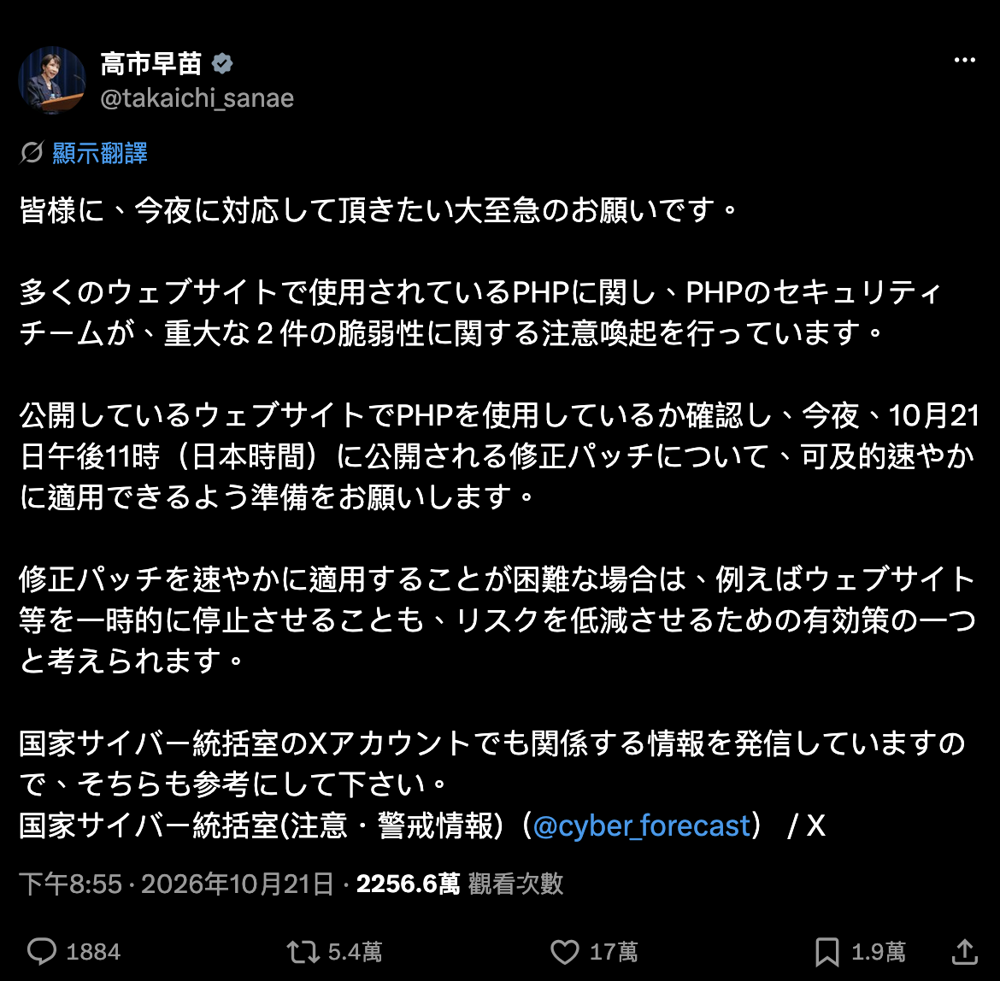
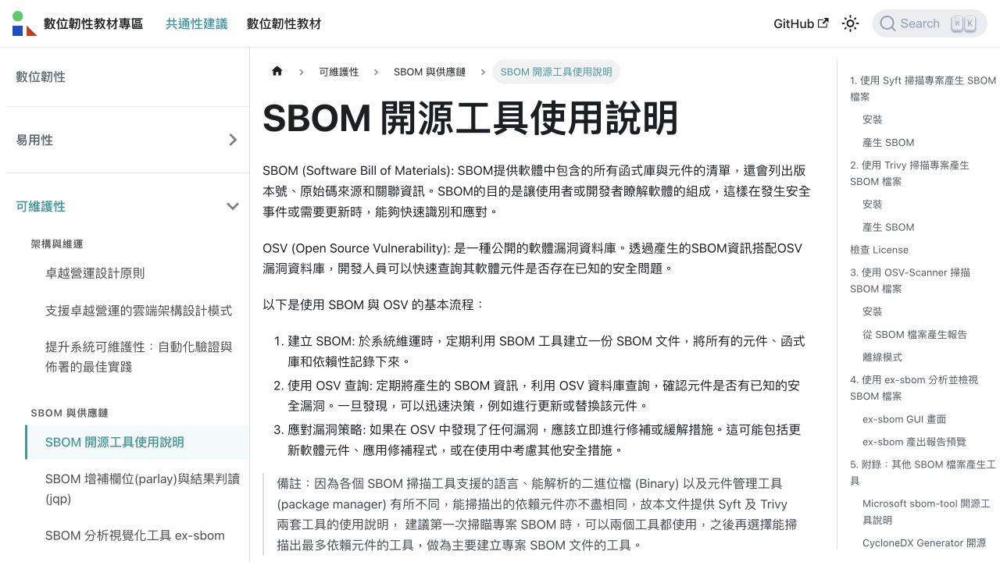
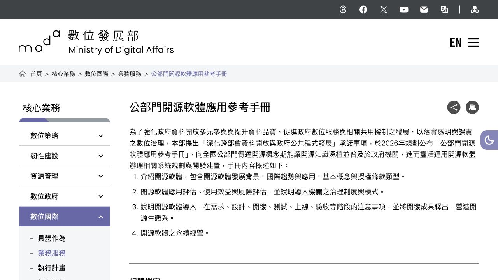
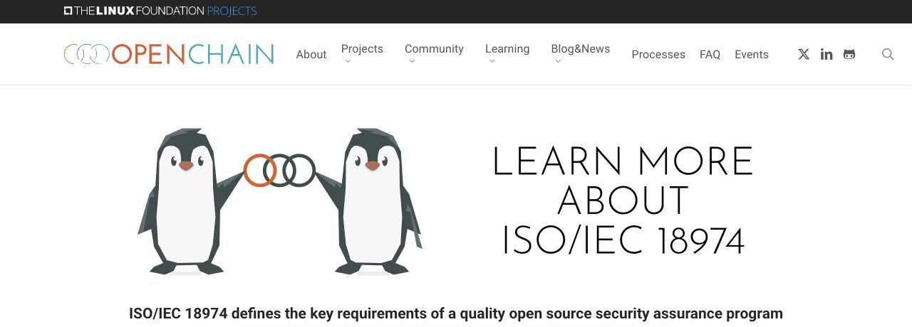

# PHP 有事，大家都有事？從高市首相的晚間緊急喊話，談藏在你服務底層的開源

**從 PHP 重大漏洞出發，談企業、政府與各種組織為什麼都需要認識自己的開源依賴，以及 SBOM 與開源安全協作能幫上什麼忙。**

編輯報導／Ian Liu (Yanyiyi)

一個開源程式語言的緊急安全更新，怎麼連高市首相都出來提醒了？

2026 年 10 月 21 日晚間，日本首相高市早苗在 X 發文，請大家確認公開網站是否使用 PHP，並準備盡速套用修補程式。如果無法即時修補，暫時停止網站服務，也是她提到的降低風險選項之一。修補原訂於日本時間當晚 11 時發布，也就是臺灣時間晚間 10 時。[〔1〕](#ref-1)[〔2〕](#ref-2)

***高市早苗在晚間發文，提醒公開網站的管理者準備因應 PHP 重大漏洞。截圖自[高市早苗 X 帳號（@takaichi_sanae）2026 年 10 月 21 日貼文](https://i.ospo.tw/php-takaichi-20261021)，由 Ian Liu 提供；畫面擷取日期：2026 年 10 月 21 日。***

這讓人聯想到「日本有事，臺灣有事」的說法；而這次更像是：**共同依賴的底層出了事，使用它的大家，都有需要處理的事。**

我們每天使用的網站與服務，背後早就有開源技術在支撐。即使服務由不同公司提供、網站放在不同主機上，也可能用到同一套開源軟體。

對臺灣的企業、政府機關與各種組織來說，這也帶來一個很真實的問題：**你知道自己公司的網站、機關採買的系統，底層用了哪一版 PHP 嗎？又用了哪些開源套件？**

「這可能要問廠商。」如果你也這樣想，那還可以接著問：廠商知道嗎？找得到紀錄嗎？真的需要更新時，又由誰來處理？

## 你可能沒碰過 PHP，但你的 WordPress 有

如果你曾經用 WordPress 經營官網、發布活動或寫文章，其實就已經在使用 PHP 支撐的服務了。只是平常登入後臺時，我們關心的是文章有沒有排好、報名連結能不能點，未必會想到網站底下還跑著什麼。[〔3〕](#ref-3)

這次值得留意的就是：**WordPress 更新了，底層的 PHP 不一定也跟著更新。** 網站程式、外掛與主機上的執行環境，可能分別由不同的人維護。

買來的商用系統也是如此。產品有自己的品牌，裡面仍可能用了許多開源軟體；交給廠商建置之後，也還是需要有人掌握它的組成與維護狀況。

我們可能沒親自安裝過某個開源元件，卻早已透過採購、委外或租用服務，成為它的使用者。

## 這次 PHP 到底出了什麼事？

PHP 官方公布的兩個重大漏洞，編號為 **CVE-2026-109618** 與 **CVE-2026-109619**，嚴重程度均為 CVSS v4.0 9.2 分，可能讓未登入的攻擊者在伺服器上遠端執行程式碼。[〔2〕](#ref-2)[〔4〕](#ref-4)

簡單來說，兩個問題都與 PHP 處理記憶體及內部資料狀態有關：一個發生在記憶體不足的處理過程，另一個則可能讓後續請求使用到記憶體已釋放、卻還殘留的舊狀態。這次需要修補的是底層執行環境，光改網站內容並不能解決。[〔2〕](#ref-2)

截至本文整理時，官方已發布 **PHP 8.5.12、8.4.27、8.3.36、8.2.35** 修補版本。若使用 Linux 發行版或長期支援服務，也要向供應商確認是否已回補修正，不能只看版本號就下結論。[〔2〕](#ref-2)

使用 PHP 不等於已經遭到入侵，實際風險也與部署方式有關。但**有使用這套開源技術的企業、政府機關與組織，都需要確認自己的環境是否受到影響。**

所以，「PHP 有事，大家都有事」要問的，是我們對共同依賴的開源基礎，究竟掌握了多少。當底層需要修補，哪些服務得一起動起來？誰知道，又由誰通知？

## 漏洞消息來了，我們知道自己用了什麼嗎？

重大漏洞一公布，最花時間的，有時候是先找出「它到底在哪裡」。

哪幾個網站用了 PHP？那套系統是哪一年買的？維護廠商還有在服務嗎？有沒有某個舊網站，大家以為沒人用了，卻一直掛在線上？

所以，我們才會持續談開源套件管理，以及 **SBOM（Software Bill of Materials，軟體物料清單）**。你可以先把它理解成軟體的成分表：記錄用了哪些元件、什麼版本，以及彼此的相依關係，讓漏洞消息出現時，有資料可以比對。[〔5〕](#ref-5)

***資安院教材將 SBOM 的建立、漏洞查詢與後續處理串成基本流程，適合用來開始練習。來源：國家資通安全研究院數位韌性教材專區〈[SBOM 開源工具使用說明](https://i.ospo.tw/nics-sbom-how-to)〉；依網站標示採 [CC BY-ND 4.0](https://i.ospo.tw/cc-by-nd-4) 授權。畫面擷取：Ian Liu，2026 年 10 月 21 日；未改寫原頁內容。***

不過，這張成分表也要看範圍。如果只列網站使用的應用程式套件，卻沒記錄底層 PHP、容器映像或作業系統套件，這次要找的資訊，可能還是不在裡面。

**SBOM 要跟著實際部署的系統更新，也要找得到負責的人。** 有了清單，再接上漏洞資訊、影響判斷與修補流程，才能讓它在需要的時候派上用場。

這件事也值得在採購時就談好：廠商會提供哪些組成資訊？發現漏洞由誰通知？更新與測試算誰的工作？維護期結束後怎麼辦？如果等到緊急事件才開始翻合約，大家恐怕都得多喝幾杯咖啡。

## 那麼，臺灣政府知道自己用了什麼嗎？

看到日本首相的提醒，我們也想問：**當同樣的漏洞警報響起，臺灣的政府機關能多快找出受影響的公共服務？** 委外系統的開源組成有沒有留下紀錄？換了承辦人或維護廠商，這些資訊還接得起來嗎？

OCF 也協助數位部撰寫面向公部門的開源應用指引。數位部公布的[《公部門開源軟體應用參考手冊》](https://i.ospo.tw/moda-open-source-guide)，涵蓋開源基本概念、風險評估、導入治理與永續經營，可以作為機關的起點。[〔7〕](#ref-7)

***數位部手冊從基本概念談到系統導入與永續經營，讓公部門有一份可以開始閱讀、討論的材料。來源：數位發展部數位國際司〈[公部門開源軟體應用參考手冊](https://i.ospo.tw/moda-open-source-guide)〉介紹頁；依該網頁標示採 [CC0 1.0](https://i.ospo.tw/cc0)。畫面擷取：Ian Liu，2026 年 10 月 21 日；未改寫原頁內容。本圖擷取的是手冊介紹網頁。***

我們期待，這些觀念能走進採購、驗收與日常維護。讓機關收到警報時，有資料能判斷影響、有窗口能追蹤修補，讓民眾使用的公共服務持續有人照顧。

## 這也是 OCF 為什麼持續推動 OpenChain ISO/IEC 18974

知道用了什麼之後，接著就是：收到漏洞消息，組織裡真的有人會接住嗎？

這也是 OCF 持續推動 **OpenChain ISO/IEC 18974** 的原因。我們希望企業與組織能把開源安全管理放進日常工作，讓盤點、判斷與處理有流程可以依循，也有人負責持續做下去。

這項開源安全保證國際標準，關注組織如何管理開源軟體的已知安全漏洞，包括在哪些環節建立流程、如何分配角色與責任，以及如何讓流程持續運作。[〔8〕](#ref-8)

***OpenChain ISO/IEC 18974 提供組織建立開源安全管理流程的共同基礎。來源：OpenChain Project〈[OpenChain ISO/IEC 18974 – Security Assurance](https://i.ospo.tw/openchain-18974)〉；網站使用條款連結至 [CC BY 4.0](https://i.ospo.tw/cc-by-4)。畫面擷取：Ian Liu，2026 年 10 月 21 日；截取頁首區域，未改寫原頁內容。***

放到這次 PHP 事件，就會變成很具體的問題：誰注意到公告？誰查出哪些產品用了 PHP？誰和供應商確認修補？又由誰回覆客戶目前的處理狀況？

標準無法讓軟體從此沒有漏洞，但可以幫助組織準備好面對漏洞。當上下游都有這樣的能力，產業聯防才更容易運作。

上游維護者發布修補，發行版與套件供應商整合更新，主機商、系統廠商部署，使用者確認服務正常。這是一段需要大家一起完成的路，任何一個環節接不上，修補就可能還沒抵達真正使用服務的人。

因此，聯防可以從分享受影響範圍、交換測試經驗、協調更新時程開始。再往前一步，我們也可以投入人力、經費與技術貢獻，支持上游維護，讓共同依賴的開源基礎有人持續照顧。

**大家都在同一艘船上，知道哪裡需要修補，也願意一起動手，才能繼續往前走。**

## 從一個系統開始，把開源管理做起來

如果想開始，不必一下子把所有工具都裝好。可以先選一個重要的對外系統，確認它用了什麼、目前由誰維護，以及漏洞消息來時要聯絡誰。

國家資通安全研究院數位韌性教材專區的 [SBOM 開源工具使用說明](https://i.ospo.tw/nics-sbom-how-to)，介紹建立元件清單、搭配 OSV 漏洞資料庫查詢，以及後續處理的基本流程，可以跟著練習。[〔5〕](#ref-5)

OCF 在[開源治理系列 09](https://i.ospo.tw/story-009)介紹的韓國 BomLens，也提供了另一個入口：讓 SBOM 資訊變得更容易理解，再帶進組織的管理工作。[〔6〕](#ref-6)

這次 PHP 事件過後，我們希望留下的，是更多組織願意問一句：**下一次漏洞出現時，我們能不能更快知道自己是否受影響，也知道該找誰一起處理？**

歡迎閱讀 [OCF 2026 年 10 月電子報](https://i.ospo.tw/ocf-news-202610)，也可以到 [OCF 電子報專區](https://i.ospo.tw/ocf-news)訂閱。在 [OCF 官網的開源治理系列](https://i.ospo.tw/ocf-stories)，我們也持續整理國際趨勢、企業實務、海外開源專案與交流活動。

開源早已支撐我們的日常。期待有更多夥伴一起認識它、管理它，也參與照顧它，讓開放協作的力量繼續走得更遠。

---

### 參考資料與圖片來源

1. [高市早苗於 2026 年 10 月 21 日的 PHP 安全提醒](https://i.ospo.tw/php-takaichi-20261021)（另參本文貼文截圖，由 Ian Liu 提供）。
2. [PHP 官方安全公告與修補版本資訊](https://i.ospo.tw/php-security)。
3. [WordPress 官方系統需求](https://i.ospo.tw/wordpress-requirements)。
4. [CERT-EU：Critical Vulnerabilities in PHP](https://i.ospo.tw/php-cert-eu-2026018)。
5. [國家資通安全研究院：SBOM 開源工具使用說明](https://i.ospo.tw/nics-sbom-how-to)；本文教材頁截圖依原站 [CC BY-ND 4.0](https://i.ospo.tw/cc-by-nd-4) 標示授權。
6. [OCF 開源治理系列 09：讓麻瓜也看懂 SBOM](https://i.ospo.tw/story-009)。
7. [數位發展部：公部門開源軟體應用參考手冊](https://i.ospo.tw/moda-open-source-guide)；本文截圖為介紹網頁，該頁標示採 [CC0 1.0](https://i.ospo.tw/cc0)。
8. [OpenChain ISO/IEC 18974：Security Assurance](https://i.ospo.tw/openchain-18974)；本文截圖來源頁面的使用條款連結至 [CC BY 4.0](https://i.ospo.tw/cc-by-4)。

*事件資料查核日期：2026 年 10 月 21 日。修補版本與處理方式請以 PHP 官方及各系統供應商最新公告為準。第三方截圖的來源、授權與畫面擷取方式，依各圖說標示。*

## 開源治理系列專文

* [#01 OCF 正式加入 OSPO 聯盟！開源治理手冊是什麼？](https://i.ospo.tw/story-001)
* [#02 OSPO 正在集結中！來自世界各地的政府開源專案辦公室](https://i.ospo.tw/story-002)
* [#03 2026 Q1 開源合規與安全調查報告：臺灣企業準備好了嗎？](https://i.ospo.tw/story-003)
* [#04 開源不只是技術選擇：AI 時代企業布局國際競爭力的起點](https://i.ospo.tw/story-004)
* [#05 OCF 前進 Sony 總部：臺灣開源治理推動經驗如何與亞洲接軌？](https://i.ospo.tw/story-005)
* [#06 串連社群、產業和政府：OCF 在 OSPOlogy Asia 2026 的分享紀實](https://i.ospo.tw/story-006)
* [#07 AI 時代的企業開源備忘錄：亞洲協作趨勢、歐盟供應鏈規範到 17 年實戰](https://i.ospo.tw/story-007)
* [#08 從「和」到一套能直接使用的文件：日本如何以 OSPO Starter Kit 支持產業](https://i.ospo.tw/story-008)
* [#09 讓麻瓜也看懂 SBOM：韓國 BomLens 如何從個人手上的風險介接到公司治理](https://i.ospo.tw/story-009)
* [#10 企業開源趨勢講堂：AI 時代的企業開源運用、管理與價值創造](https://i.ospo.tw/issue10)
* [#11 企業用了開源之後：責任、技術依賴與社群回饋的現場對話](https://i.ospo.tw/issue11)
* [#12 PHP 有事，大家都有事？從高市首相的晚間緊急喊話，談藏在你服務底層的開源](https://i.ospo.tw/story-012)
