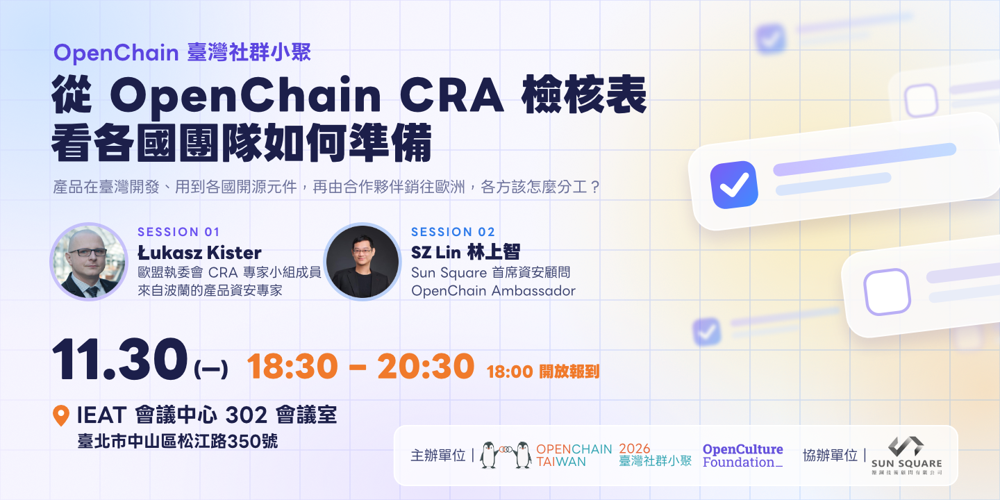
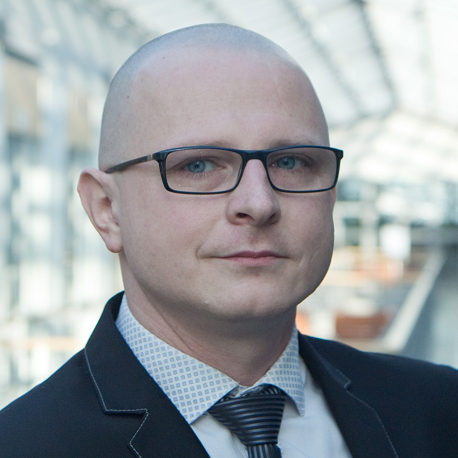
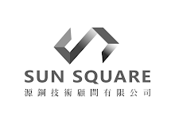
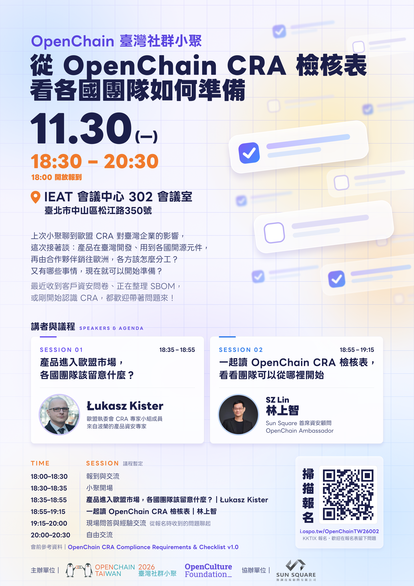

# 從 OpenChain CRA 檢核表，看各國團隊如何準備

撰文編輯／Ian Liu (Yanyiyi)

*活動主視覺由活動團隊提供。*

一項產品在臺灣開發，使用來自不同國家的開放原始碼元件，再由合作夥伴銷往歐洲，參與其中的團隊該如何分工？客戶提出資安問卷時，哪些資料已經備妥，哪些問題需要先和供應商釐清？

上次 OpenChain 臺灣社群小聚談到歐盟《網路韌性法》（Cyber Resilience Act，CRA）對臺灣企業的影響，這次將接著討論實際的準備工作。兩場短講分別從跨國供應鏈與 OpenChain CRA 檢核表出發，再透過現場問答與經驗交流，一起整理團隊可以開始嘗試的做法。

本次邀請歐盟執委會 CRA 專家小組成員、來自波蘭的產品資安專家 **Łukasz Kister**，以及 Sun Square 首席資安顧問、OpenChain Ambassador **SZ Lin 林上智** 分享。無論你最近收到客戶資安問卷、正在整理軟體物料清單（SBOM），或剛開始認識 CRA，都歡迎帶著問題參加。

<a class="ui primary button" href="https://openchain.kktix.cc/events/26meetup-002">立即報名 OpenChain 臺灣社群小聚</a>

## 活動資訊

* 活動名稱：OpenChain 臺灣社群小聚 002｜從 OpenChain CRA 檢核表，看各國團隊如何準備
* 日期：2026 年 11 月 30 日（一）
* 時間：18:30–20:30（18:00 開放報到）
* 地點：IEAT 會議中心 302 會議室
* 地址：臺北市中山區松江路 350 號（[Google 地圖](https://www.google.com/maps/search/?api=1&query=IEAT%E6%9C%83%E8%AD%B0%E4%B8%AD%E5%BF%83+%E8%87%BA%E5%8C%97%E5%B8%82%E4%B8%AD%E5%B1%B1%E5%8D%80%E6%9D%BE%E6%B1%9F%E8%B7%AF350%E8%99%9F)）
* 主辦單位：OpenChain 臺灣社群、財團法人開放文化基金會（OCF）
* 協辦單位：Sun Square 源鋼技術顧問有限公司
* 費用：免費，請事先報名
* 報名方式：[KKTIX 線上報名](https://openchain.kktix.cc/events/26meetup-002)，歡迎在報名表留下想討論的問題

## 議程

| 時間 | 議程 | 講者 |
| --- | --- | --- |
| 18:00–18:30 | 報到與交流 | — |
| 18:30–18:35 | 小聚開場 | — |
| 18:35–18:55 | 產品進入歐盟市場，各國團隊該留意什麼？ | Łukasz Kister |
| 18:55–19:15 | 一起讀 OpenChain CRA 檢核表，看看團隊可以從哪裡開始 | SZ Lin 林上智 |
| 19:15–20:00 | 現場問答與經驗交流：從報名時收到的問題聊起 | 現場參與者與講者 |
| 20:00–20:30 | 自由交流 | 全體參與者 |

*議程暫定；本文依活動海報列示，現場安排如有調整，請留意主辦單位公告。*

## 講題一｜產品進入歐盟市場，各國團隊該留意什麼？

**時間：18:35–18:55**

**講者：Łukasz Kister｜歐盟執委會 CRA 專家小組成員**

產品走向歐盟市場，往往涉及不同國家的開發團隊、元件供應商與銷售夥伴。本場將從這樣的合作情境出發，分享各國團隊面對 CRA 時需要留意的事，並討論如何釐清自己在供應鏈中的角色，以及有哪些事項值得提早和海外客戶、供應商確認。

## 講題二｜一起讀 OpenChain CRA 檢核表，看看團隊可以從哪裡開始

**時間：18:55–19:15**

**講者：SZ Lin 林上智｜Sun Square 首席資安顧問｜OpenChain Ambassador**

本場將介紹 OpenChain CRA Compliance Requirements & Checklist v1.0，從 SBOM、漏洞處理與技術文件等項目，帶大家盤點現有流程，找出已有紀錄可以支持的做法，以及還需要補齊的工作。

例如，整理好 SBOM 之後，若供應商通知某個元件有漏洞，團隊能否找到受影響的產品版本？誰來判斷與處理，過程又記錄在哪裡？這些日常工作中的問題，都可以成為檢視準備進度的起點。

## 講者介紹

  

    

      
    

    

      
Łukasz Kister

      
歐盟執委會 CRA 專家小組成員

      
來自波蘭的產品資安專家，本次將從產品進入歐盟市場與跨國供應鏈的角度，分享各國團隊的準備方向。

    

  

  

    

      
    

    

      
SZ Lin 林上智

      
Sun Square 首席資安顧問｜OpenChain Ambassador

      
本次將帶領大家認識 OpenChain CRA 檢核表，從軟體物料清單、漏洞處理與技術文件等實務項目，討論團隊可以如何開始準備。

    

  

*講者照片由活動團隊提供。*

## 帶著工作中的問題來交流

小聚除了兩場短講，也安排現場問答與經驗交流。歡迎在報名時提出一個來自工作現場的問題，說說團隊已經試過哪些方法、目前卡在哪裡。剛開始挑選產品試行，或已經準備將既有做法推向其他產品線的經驗，都適合帶來討論。

## 會前參考資料

* [OpenChain CRA Compliance Requirements & Checklist](https://cra-compliance.openchainproject.org/CRA_Checklist_latest.html)：本次小聚介紹 v1.0，連結會提供最新版本。
* [OpenChain 臺灣社群官網](https://openchain-project.github.io/OpenChain-TWG/)
* [OpenChain 臺灣社群 Telegram 討論群組](https://t.me/joinchat/O6BDhVXYm17Bm8_4s-aZIg)
* [OpenChain Project 官網](https://openchainproject.org/)

## 協辦單位

**Sun Square 源鋼技術顧問有限公司**

## 活動海報與報名

*活動海報由活動團隊提供。*

<a class="ui primary button" href="https://openchain.kktix.cc/events/26meetup-002">立即報名｜11 月 30 日臺北見</a>

活動相關問題，歡迎來信 [hi@ocf.tw](mailto:hi@ocf.tw) 或 [taiwan-wg@lists.openchainproject.org](mailto:taiwan-wg@lists.openchainproject.org)。

## 開源治理系列專文

* [#01 OCF 正式加入 OSPO 聯盟！開源治理手冊是什麼？](https://ocf.tw/story/ospos-1-join-OSPO-alliance/)
* [#02 OSPO 正在集結中！來自世界各地的政府開源專案辦公室](https://ocf.tw/story/ospos-2-floss-pso-intl-network/)
* [#03 2026 Q1 開源合規與安全調查報告：臺灣企業準備好了嗎？](https://ocf.tw/story/ospos-3-taiwan-open-compliance-security-report-2026-q1/)
* [#04 開源不只是技術選擇：AI 時代企業布局國際競爭力的起點](https://ocf.tw/story/open-source-business-ai-competitiveness-2026/)
* [#05 OCF 前進 Sony 總部：臺灣開源治理推動經驗如何與亞洲接軌？](https://ocf.tw/story/ospos-5-ospology-asia-sony-2026/)
* [#06 串連社群、產業和政府：OCF 在 OSPOlogy Asia 2026 的分享紀實](https://ocf.tw/story/ospos-6-start-before-formal-ospo/)
* [#07 AI 時代的企業開源備忘錄：亞洲協作趨勢、歐盟供應鏈規範到 17 年實戰](https://ocf.tw/story/ospos-7-enterprise-open-source-memo-2026/)
* [#08 從「和」到一套能直接使用的文件：日本如何以 OSPO Starter Kit 支持產業](https://ocf.tw/story/ospos-8-japan-ospo-starter-kit/)
* [#09 讓麻瓜也看懂 SBOM：韓國 BomLens 如何從個人手上的風險介接到公司治理](https://ocf.tw/story/ospos-9-korea-bomlens/)
* [#10 企業開源趨勢講堂：AI 時代的企業開源運用、管理與價值創造](https://ocf.tw/story/ospos-10-enterprise-open-source-ai-2026/)
* [#11 企業用了開源之後：責任、技術依賴與社群回饋的現場對話](https://ocf.tw/story/ospos-11-enterprise-open-source-memo-recap-2026/)
* [#12 PHP 有事，大家都有事？從高市首相的晚間緊急喊話，談藏在你服務底層的開源](https://i.ospo.tw/story-012)
* [#13 從 OpenChain CRA 檢核表，看各國團隊如何準備](https://ocf.tw/story/ospos-13-openchain-cra-checklist-2026/)
