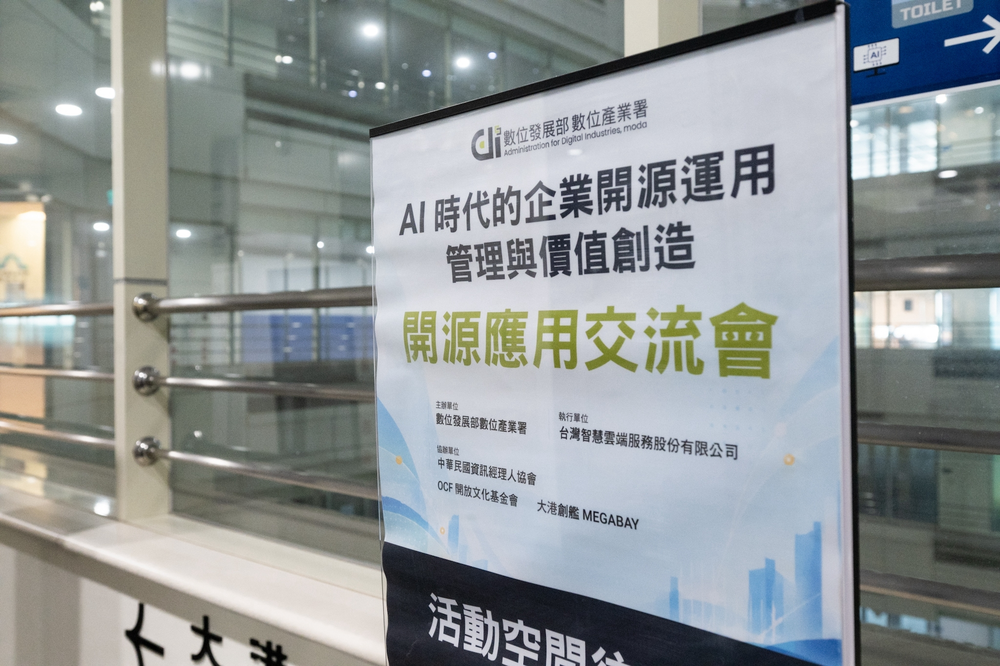
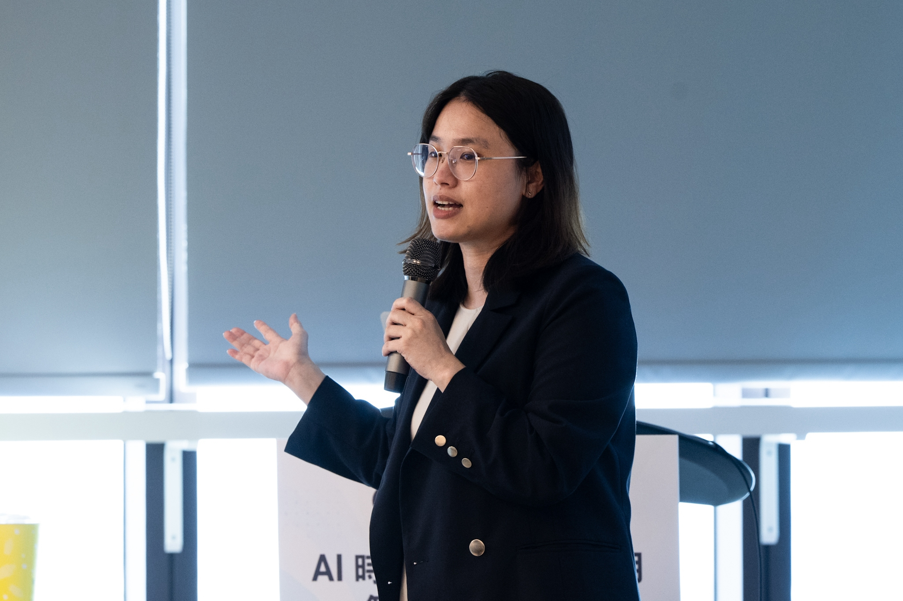
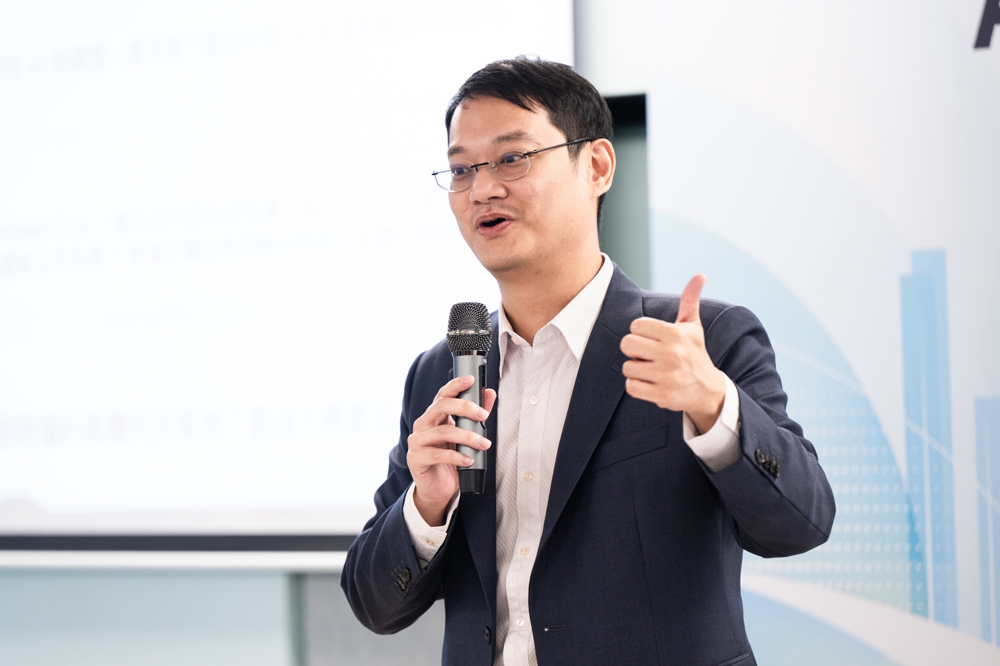
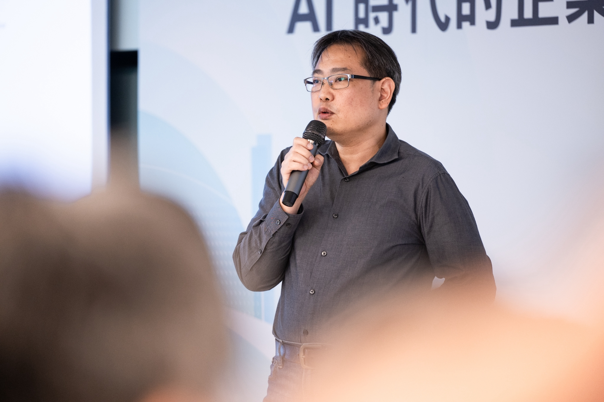
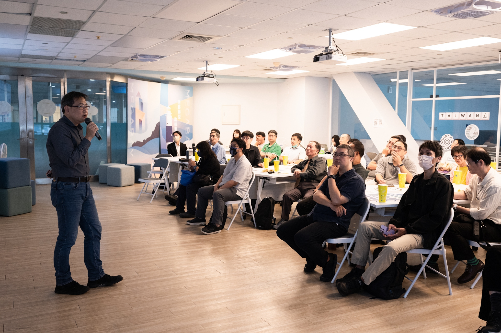
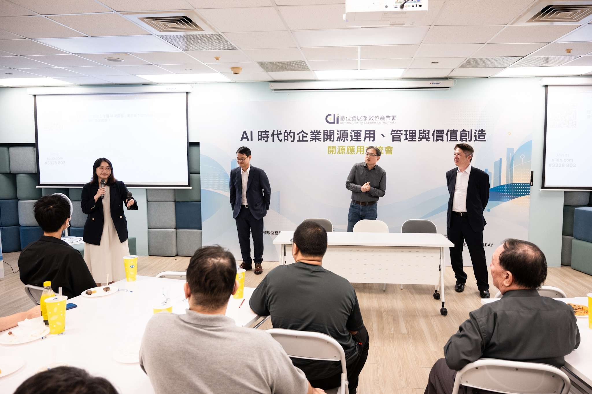
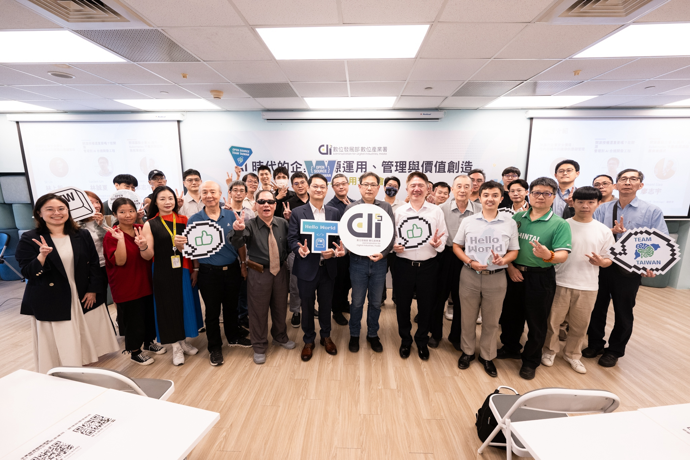

# 〖開源治理系列 14〗AI 寫進企業開發流程之後，開源怎麼管？｜11 月 4 日高雄場紀錄

活動紀錄：黃映綺（@qiqihuang77） 
文章編輯：劉俊彥（Ian Liu）

同一個開源元件被多項產品共用，出了問題誰來修？AI 改寫的程式碼要怎麼審？11 月 4 日高雄場從供應鏈安全、授權合規與 AI 維運，談企業如何把開源治理做進開發流程。

*11 月 4 日企業開源趨勢講堂的現場海報。攝於 2026 年 11 月 4 日。圖／IMA 資訊經理人協會，[CC BY 4.0](https://creativecommons.org/licenses/by/4.0/deed.zh-hant)。*

2026 年 11 月 4 日，「企業開源趨勢講堂：AI 時代的企業開源運用、管理與價值創造」在高雄大港創艦 MEGABAY 舉行。活動由數位發展部數位產業署主辦、台灣智慧雲端服務股份有限公司執行，資訊經理人協會（IMA）、開放文化基金會（OCF）與大港創艦 MEGABAY 協辦，由 OCF 執行長 Singing 李欣穎主持。[活動介紹與議程](https://ocf.tw/story/ospos-10-enterprise-open-source-ai-2026/)

IMA 秘書長 Marie 璩秀君在開場提到，台灣的產業發展若要往軟體產品化走，開源軟體可以成為企業共同使用的基礎。上一篇會後紀錄談企業用了開源之後的維護責任與社群回饋。到了高雄場，三位講者把問題帶到開發現場：元件修補怎麼送到每條產品線？AI 生成的程式碼怎麼驗收？開源技術做成服務之後，客戶願意為什麼付費？[開源治理系列 11｜企業用了開源之後](https://ocf.tw/story/ospos-11-enterprise-open-source-memo-recap-2026/)

*開放文化基金會執行長 Singing 李欣穎主持高雄場。攝於 2026 年 11 月 4 日。圖／IMA 資訊經理人協會，[CC BY 4.0](https://creativecommons.org/licenses/by/4.0/deed.zh-hant)。*

## 同一套元件可以一起修，交付前要由誰驗證？

Sun Square 首席資安顧問、Debian 開發者 SZ Lin 林上智從 Linux 核心談起。一項修改會先經過相關維護者討論與審查，再逐層整合。討論能不能追查、誰有權審查、誰負責把修改納入版本，都是協作能長期運作的條件。企業也可以把這套方法帶到內部。透過 InnerSource，讓其他團隊在既有權限範圍內找到共用元件、提出修改，並看到維護者為何接受或退回建議。

他以多條產品線共用同一個元件為例。負責元件的團隊可以集中修補、測試並發布新版，各產品團隊仍要確認自己用了哪一版、評估修補的影響，並完成整合測試。交付時，軟體物料清單（SBOM）要跟實際交到客戶手上的版本對得起來。這樣下次收到弱點通報，團隊才查得到哪些產品可能受影響，以及誰負責處理。

*SZ Lin 林上智分享企業開源治理與軟體供應鏈安全。攝於 2026 年 11 月 4 日。圖／IMA 資訊經理人協會，[CC BY 4.0](https://creativecommons.org/licenses/by/4.0/deed.zh-hant)。*

遇到自行修改的元件，他也分享「上游優先」（Upstream First）的做法。先確認授權與可公開的範圍，再和原開源專案討論能否納入修補。上游採納後，公司可能少維護一份自己的修改，也有機會得到其他維護者的回饋。這些往來需要工時，修補可能被要求重寫，企業也要安排負責人持續追蹤版本。

談到供應鏈信任時，SZ 用 XZ Utils 事件提醒，幾種證據各有用途。SBOM 用來查產品有哪些元件，數位簽章用來驗證簽署者與內容完整性，建置來源資訊（provenance）則記錄產物如何建置。當某個元件傳出弱點，企業可透過 VEX（弱點可利用性交換）記錄特定產品是否受影響及判斷依據，並在版本或證據改變後更新。這些紀錄也有助於釐清歐盟《網路韌性法案》（CRA）下的產品責任：企業整合了第三方元件，仍要能追溯交付版本，並安排弱點評估與修補。[歐盟《網路韌性法案》介紹](https://digital-strategy.ec.europa.eu/en/policies/cyber-resilience-act)

*SZ Lin 林上智與現場與會者交流。攝於 2026 年 11 月 4 日。圖／IMA 資訊經理人協會，[CC BY 4.0](https://creativecommons.org/licenses/by/4.0/deed.zh-hant)。*

## AI 可以幫忙改程式，開源授權還要怎麼查？

群牧開源管理顧問負責人、台灣開源法律網絡共同創辦人 Lucien Lin 林誠夏以 Python 套件 chardet 為例。早期版本採用 LGPL，7.0.0 發布時，維護方表示這是一次有 AI 協助的重寫，並以 MIT 授權發布。原作者質疑重寫是否真正獨立，以及維護方能否改用新的授權。這件事讓現場回到一個具體的審查問題：團隊能不能說明參考了哪些資料，以及最後交付的程式碼是怎麼寫出來的？[chardet 7.0.0 版本說明](https://chardet.readthedocs.io/en/7.0.0/changelog.html)｜[原作者提出的公開討論](https://github.com/chardet/chardet/issues/327)

*Lucien Lin 林誠夏分享開源授權與 AI 合規開發。攝於 2026 年 11 月 4 日。圖／IMA 資訊經理人協會，[CC BY 4.0](https://creativecommons.org/licenses/by/4.0/deed.zh-hant)。*

Lucien 也比較了常見的授權條款。採用 MIT、BSD 類授權的程式碼，仍要依條款保留相關聲明。GPL 類授權涉及散布時的義務，得看實際採用的版本、整合方式和交付情境。Apache-2.0 則另有專利授權及商標相關條款。這些差異會影響產品怎麼組合、改寫與交付，值得在選用元件時就確認。

他介紹「淨室開發」（Clean-room development）時，用功能概念與程式碼表達來說明重新實作的界線。團隊可以從規格與可觀察的行為理解功能，再獨立實作，並保留足以回頭檢視的開發紀錄。用 AI 批次改寫第三方程式碼，仍可能保留原有的表達。Lucien 建議先把 AI 用在協助找錯、補測試或提出修正，再由工程師檢查生成結果、掌握來源並留下版本紀錄。程式碼進入產品後，團隊也要有人能讀懂、審查與維護。[經濟部智慧財產局｜著作權法第 10 條之 1](https://www.tipo.gov.tw/tw/copyright/694-17731.html)

*Lucien Lin 林誠夏與與會者交流。攝於 2026 年 11 月 4 日。圖／IMA 資訊經理人協會，[CC BY 4.0](https://creativecommons.org/licenses/by/4.0/deed.zh-hant)。*

## 從 Kubernetes 到 AI 服務，客戶願意為什麼付費？

寬橋有限公司（Brobridge）總經理 Armani Liao 廖志宇從產品化談起。開源軟體讓企業有現成的技術可以運用，客戶願意付費的，往往是把這些技術接進既有系統、穩定上線，以及出問題時有人接手。他區分了兩種做法：依顧問、導入或維運等工作收取服務費，或以產品訂閱、使用規模與資源用量設計收費。

他以 Kubernetes 為例說明，一個企業應用要持續運作，需要團隊分工。平台工程負責設計部署架構，DevSecOps 把供應鏈安全與權限管理放進開發流程，SRE（網站可靠性工程）則關注上線後的可靠性。到了 AI 應用，還得接上企業原有的資料與流程。即使有算力，資料用不上、權限分不清，或部署完沒人維護，試作成果也很難變成日常服務。

這也回到他談的商業模式：企業可以在開源技術上做出自己的產品特色，並用持續維護、整合與支援的能力取得收入。服務交付得愈穩定，客戶就愈能看見這筆投入的價值。

## 現場問答｜怎麼說服公司投資開源治理？

*Singing 李欣穎主持綜合討論，三位講者一同回應現場提問。攝於 2026 年 11 月 4 日。圖／IMA 資訊經理人協會，[CC BY 4.0](https://creativecommons.org/licenses/by/4.0/deed.zh-hant)。*

### 成立 OSPO，要怎麼和投資報酬率連在一起？

Lucien 觀察到，有些公司是因客戶、供應鏈或授權合規的要求，才開始設置開源專案辦公室（OSPO）。SZ 分享，他會先找出工程、法務、資安等利害關係人，確認各部門承擔的工作與能得到的好處，再把目標和成本說清楚。例如，共用元件的修補有多少重工？合規資料準備得更完整，能否縮短客戶審查的時間？這類問題能讓主管從既有工作看見投入的價值。Marie 補充，管理階層和董事會若能理解開源與公司的業務有何關係，才有機會把資源和權責帶進整間公司。

### ISO/IEC 18974 和 27001 有什麼差別？兩個都要做嗎？

SZ 說明，ISO/IEC 18974 聚焦開源軟體安全保證，例如如何管理已知弱點。ISO/IEC 27001 規範的是組織的資訊安全管理系統。現場也提到，OpenChain 的另一項標準 ISO/IEC 5230，聚焦開源授權合規。企業可依客戶與供應鏈要求、標案條件，以及現有管理流程來判斷導入的順序。有與會者詢問開源授權諮詢管道，現場提到可以先從 OpenChain 的公開資源找起。[OpenChain｜開源軟體安全保證](https://openchainproject.org/security-assurance)｜[OpenChain｜開源授權合規](https://openchainproject.org/licensecompliancespecification)｜[ISO｜ISO/IEC 27001](https://www.iso.org/standard/27001)

### 對 AI 下一句「不要引用 GPL 專案」，夠嗎？

Armani 回應，大型開發工作還需要測試環境、版本控管與上線前的審查。公司可以先訂清楚哪些元件和用途獲准使用，哪些變更需要由人審查，以及新產出的程式碼要經過哪些測試才能進入既有系統。他也提到，企業回饋上游時要預留處理審查意見與後續維護的時間，讓開源貢獻能排進日常工作。

## 把開源治理放進日常工作

高雄場從一個共用元件的修補，談到一段 AI 生成的程式碼如何入庫，最後回到一項服務如何穩定交付。這些工作分屬不同團隊，卻常要在同一次產品發布前接起來。當有人能說明元件從哪裡來、改了什麼、怎麼驗證、上線後由誰接手，企業就有一套可以隨產品一起維護的開源治理流程。

*11 月 4 日高雄場活動合照。攝於 2026 年 11 月 4 日。圖／IMA 資訊經理人協會，[CC BY 4.0](https://creativecommons.org/licenses/by/4.0/deed.zh-hant)。*

## 活動資料與延伸閱讀

- [開源治理系列 10｜11 月 4 日企業開源趨勢講堂活動介紹](https://ocf.tw/story/ospos-10-enterprise-open-source-ai-2026/)
- [開源治理系列 11｜企業用了開源之後：責任、技術依賴與社群回饋的現場對話](https://ocf.tw/story/ospos-11-enterprise-open-source-memo-recap-2026/)
- [OpenChain｜開源授權合規 ISO/IEC 5230](https://openchainproject.org/licensecompliancespecification)
- [OpenChain｜開源軟體安全保證 ISO/IEC 18974](https://openchainproject.org/security-assurance)

## 開源治理系列專文

* [#01 OCF 正式加入 OSPO 聯盟！開源治理手冊是什麼？](https://ocf.tw/story/ospos-1-join-OSPO-alliance/)
* [#02 OSPO 正在集結中！來自世界各地的政府開源專案辦公室](https://ocf.tw/story/ospos-2-floss-pso-intl-network/)
* [#03 2026 Q1 開源合規與安全調查報告：臺灣企業準備好了嗎？](https://ocf.tw/story/ospos-3-taiwan-open-compliance-security-report-2026-q1/)
* [#04 開源不只是技術選擇：AI 時代企業布局國際競爭力的起點](https://ocf.tw/story/open-source-business-ai-competitiveness-2026/)
* [#05 OCF 前進 Sony 總部：臺灣開源治理推動經驗如何與亞洲接軌？](https://ocf.tw/story/ospos-5-ospology-asia-sony-2026/)
* [#06 串連社群、產業和政府：OCF 在 OSPOlogy Asia 2026 的分享紀實](https://ocf.tw/story/ospos-6-start-before-formal-ospo/)
* [#07 AI 時代的企業開源備忘錄：亞洲協作趨勢、歐盟供應鏈規範到 17 年實戰](https://ocf.tw/story/ospos-7-enterprise-open-source-memo-2026/)
* [#08 從「和」到一套能直接使用的文件：日本如何以 OSPO Starter Kit 支持產業](https://ocf.tw/story/ospos-8-japan-ospo-starter-kit/)
* [#09 讓麻瓜也看懂 SBOM：韓國 BomLens 如何從個人手上的風險介接到公司治理](https://ocf.tw/story/ospos-9-korea-bomlens/)
* [#10 企業開源趨勢講堂：AI 時代的企業開源運用、管理與價值創造](https://ocf.tw/story/ospos-10-enterprise-open-source-ai-2026/)
* [#11 企業用了開源之後：責任、技術依賴與社群回饋的現場對話](https://ocf.tw/story/ospos-11-enterprise-open-source-memo-recap-2026/)
* [#12 PHP 有事，大家都有事？從高市首相的晚間緊急喊話，談藏在你服務底層的開源](https://i.ospo.tw/story-012)
* [#13 從 OpenChain CRA 檢核表，看各國團隊如何準備](https://ocf.tw/story/ospos-13-openchain-cra-checklist-2026/)
* [#14 AI 寫進企業開發流程之後，開源怎麼管？｜11 月 4 日高雄場紀錄](https://ocf.tw/story/ospos-14-enterprise-open-source-ai-recap-2026/)
* [#15 企業開源趨勢講堂：AI 與開源競爭力－從在地技術採用到全球生態](https://ocf.tw/story/ospos-15-ai-open-source-competitiveness-2026/)
