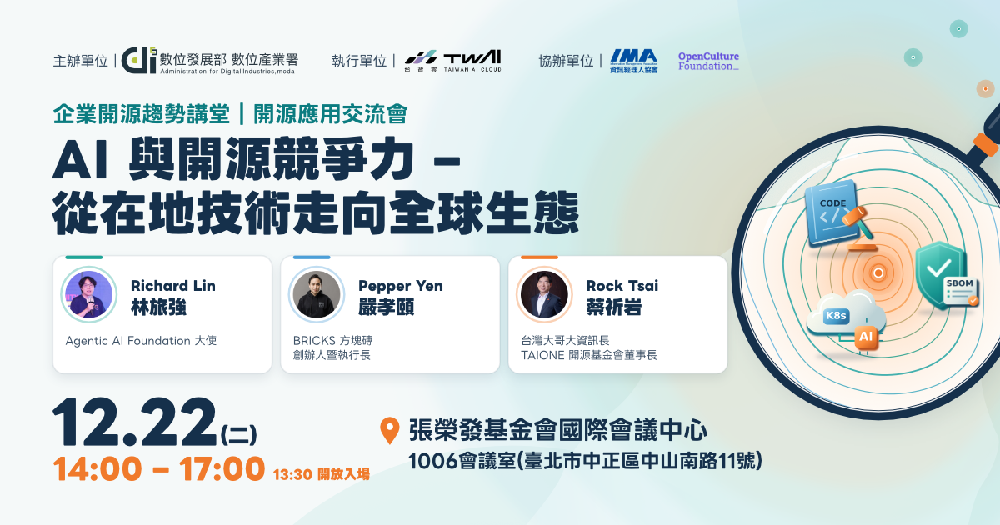
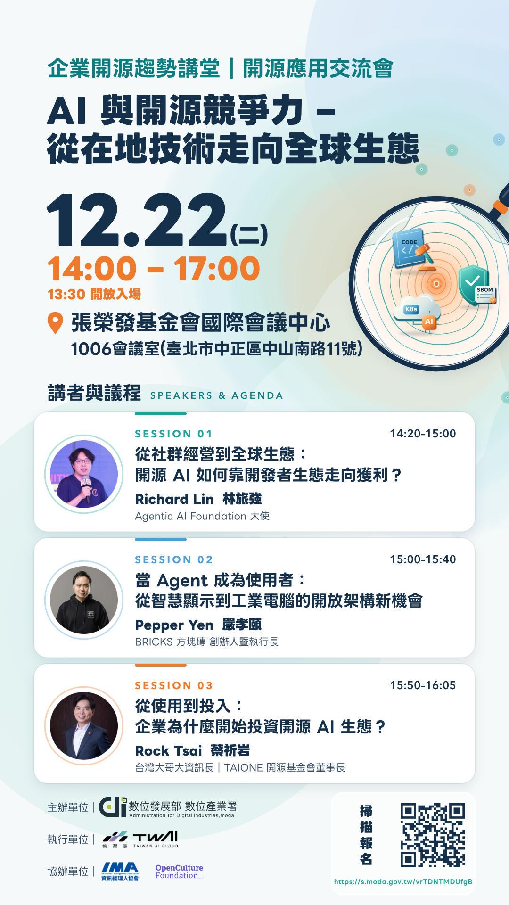

# 企業開源趨勢講堂：AI 與開源競爭力－從在地技術採用到全球生態

撰文編輯／Ian Liu (Yanyiyi)

當 AI 從模型與對話介面走進企業系統、邊緣裝置與實體場域，企業的課題也從「採用哪些技術」，延伸至「哪些基礎值得共同建設」。模型推論、Agent 執行、設備介面與部署管理，都需要跨企業、跨硬體平臺協作，才能形成可持續採用與維護的技術生態。當 Agent 開始操作設備、參與現場工作流程，軟硬體之間如何溝通、管理權限與持續更新，也成為產業共同面對的問題。

對臺灣而言，下一個機會在於將既有的硬體、軟體與場域整合優勢，進一步連結全球開發者與國際開源專案。透過開放介面、共通規格與可重複使用的軟體元件，企業有機會減少重複整合，讓更多資源投入產品創新。但哪些能力適合開放共用？合作夥伴同時也是競爭者時，如何建立信任？各家公司又如何在共同基礎上，發展客戶願意付費的產品與服務？

本次邀請長期投入國際開源與開發者生態的林旅強、BRICKS 方塊磚創辦人暨執行長嚴孝頤，以及台灣大哥大資訊長蔡祈岩，分別從開源商業與國際開發者生態、實體場域 Agentic OS，以及企業投入開源 AI 的條件出發，探討如何從技術使用走向共同建設、國際協作與價值創造。並透過綜合座談，交流人才、資源、治理與商業回報之間的實務取捨。

歡迎關注 AI 布局與開源商業模式的企業主及主管、探索智慧設備與邊緣 AI 應用的產業夥伴，以及發展 AI 平臺、軟體服務與場域整合的技術團隊參與；也邀請負責產品策略、開發者關係與開源治理的夥伴，一起探索臺灣產業連結國際開源生態的合作機會。

<a class="ui primary button" href="https://i.ospo.tw/261222ADI">立即報名企業開源趨勢講堂</a>

## 活動資訊

* 日期：2026 年 12 月 22 日（二）
* 時間：14:00–17:00（13:30 開放入場）
* 地點：張榮發基金會國際會議中心 1006 會議室
* 地址：臺北市中正區中山南路 11 號 10 樓
* 主持人：Singing 李欣穎｜財團法人開放文化基金會（OCF）執行長
* 主辦單位：數位發展部數位產業署
* 執行單位：台灣智慧雲端服務股份有限公司
* 協辦單位：中華民國資訊經理人協會（IMA）、財團法人開放文化基金會（OCF）
* 報名方式：[線上報名](https://i.ospo.tw/261222ADI)

## 議程總表

| 時間 | 議程 |
| :---- | :---- |
| 13:30–14:00 | 報到與入場 |
| 14:00–14:10 | 活動開場與引言 |
| 14:10–14:20 | 長官致詞與大合照 |
| 14:20–14:55 | 林旅強 ｜從社群經營到全球生態： 開源 AI 如何靠開發者生態走向獲利？ |
| 14:55–15:00 | 議程交流與 Q&A |
| 15:00–15:35 | 嚴孝頤｜當 Agent 成為使用者： 從智慧顯示到工業電腦的開放架構新機會 |
| 15:35–15:40 | 議程交流與 Q&A |
| 15:40–15:50 | 中場休息 |
| 15:50–16:05 | 蔡祈岩｜從使用到投入： 企業為什麼開始投資開源 AI 生態？ |
| 16:05–16:50 | 臺灣開源與 AI 生態的下一步！誰來共同建設，誰能一起創造收益｜主持：李欣穎；與談：林旅強、嚴孝頤、蔡祈岩 |
| 16:50–17:00 | 企業的第一步・活動結語 |

## 講題一｜從社群經營到全球生態：開源 AI 如何靠開發者生態走向獲利？

*開源技術的價值，不只在於程式碼能被自由取得，更在於能否讓使用者持續參與，形成跨組織、跨市場的合作關係。本場從臺灣自由軟體鑄造場的經驗出發，分享如何將在地開源社群的經營方法延伸出海到國際開發者生態，並探討 AI 時代的企業如何透過開源協作，從技術採用走向產品發展與商業價值。*

**Richard Lin 林旅強**   
**美商 Datastrato 生態副總裁｜前中央研究院自由軟體鑄造場推動者**

臺灣早期透過自由軟體鑄造場與技術社群，累積開源推廣與協作經驗。技術要真正被採用，除了程式碼與文件，也需持續回應問題、連結使用者，讓新參與者融入社群。從臺灣到國際市場，產業與開發者需求雖有差異，核心課題卻相近：如何讓技術從下載與試用，走向實際部署、持續貢獻及長期合作？企業又該如何建立信任，讓使用者成為共同投入的夥伴？

AI 模型、推論框架與開發工具快速發展，取得技術愈來愈容易，經營生態仍需長期投入。本場結合 01.AI、華為雲與 Apache Gravitino 經驗，探討如何從下載量、GitHub Stars，到導入、貢獻與商業合作，衡量開源成果。

林旅強在 Community Over Code Asia 2026，曾探討企業投資開發者生態、社群健康、使用者轉為貢獻者，以及商業化與信任的平衡。本場將進一步討論：共用技術保持開放時，企業如何透過效能最佳化、企業整合、部署維運、場域經驗及夥伴關係，創造客戶願意付費的差異化價值？又該如何兼顧商業成果與開發者信任？

### 講者 Bio

長期投入開放原始碼與開發者生態經營，曾參與中央研究院自由軟體鑄造場（OSSF），亦為 COSCUP 的長期貢獻者之一。2014 年共同創辦開源社，並為現任 2026 屆理事長。曾負責 01.AI 全球開源生態及華為雲 AI 開發者生態，現任 Datastrato 生態副總裁（VP of Ecosystem），推動 Apache Gravitino 生態發展。經驗橫跨臺灣、中國與美國矽谷，關注開源專案治理、開發者體驗與商業模式，譯有《開源項目成功之道》及《開發者關係：方法與實踐》。

## 講題二｜當 Agent 成為使用者：從智慧顯示到工業電腦的開放架構新機會

*當 AI Agent 開始操作實體設備，為人設計的介面與系統架構也面臨新需求。本場從 BRICKS 的智慧顯示與商業場域經驗出發，探討 Agentic OS、開放介面與產業協作，如何串聯工業電腦與邊緣 AI，為臺灣硬體產業創造新機會。*

**嚴孝頤 Pepper Yen**  
**BRICKS 方塊磚創辦人暨執行長**

從數位菜單、互動看板到自助服務，BRICKS 將軟體帶入餐飲與零售現場，也面對硬體整合、設備部署、遠端管理與長期維護等挑戰。如果每種設備、每個場域都需重新整合，軟體服務該如何有效擴展？

AI Agent 的發展，讓這個問題有了新的層次。當設備的使用者從人延伸至 Agent，系統必須讓它辨識現場設備、理解可執行的動作，並在明確的權限與規則下呼叫工具。AI 開始參與實體工作流程，也推動軟硬體架構重新調整。從智慧顯示走向工業電腦，意味著進一步連結感測器、周邊裝置與營運系統。本場將結合 BRICKS 與開元通訊（InnoComm）的合作經驗，探討 Agent 從理解任務到操作設備所需的能力，包括本地推論、設備辨識、工具調用、權限管理及跨硬體部署維運。

讓一臺設備支援 Agent，與讓不同廠商的設備彼此協作，涉及不同層次的挑戰。透過開放介面、共通規格與可重複使用的軟體元件，晶片商、設備製造商、開發者與系統整合商，有機會減少重複整合，將資源投入各自具有差異化的產品與服務。臺灣具備晶片、工業電腦與場域整合優勢，如何讓全球開發者更容易在這些硬體上建立、部署與維護 AI Agent？本場將從創業與產品經營的角度，討論開源及開放架構如何支持產業協作，讓臺灣硬體成為國際開發者生態共同使用的技術基礎。

### 講者 Bio

嚴孝頤（Pepper Yen）為 BRICKS 方塊磚創辦人暨執行長，具軟體開發、產品經營與創業經驗，從互動服務、智慧顯示到商業場域應用，持續推動可部署、可長期營運的產品。目前帶領團隊投入 Edge AI 與 Agentic OS，探索透過開放架構、軟硬體整合及產業合作，拓展臺灣硬體的 AI 應用機會。

## 講題三｜從使用到投入：企業為什麼開始投資開源 AI 生態？

*企業導入 AI 後，如何持續累積人才、工具鏈與關鍵技術？本場從企業 AI 轉型與 TAIONE 的推動方向出發，探討企業如何從開源使用者走向生態投入者，讓人才培育、專案貢獻與國際參與，轉化為產品與組織能力。*

**講者：蔡祈岩 Rock Tsai**  
**台灣大哥大資訊長｜開源基金會（TAIONE）董事長**

企業採用開源，常從降低成本、縮短開發時程開始。但當 AI 基礎建設愈來愈依賴全球開源專案，人才培養、專案維護與技術方向，又該由誰長期投入？

當 AI 從單點工具走向企業系統與 Agentic AI 應用，技術投入也需要重新思考。本場將從企業轉型經驗出發，討論如何讓開源投入支持核心流程，並累積可持續發展的技術能力。

TAIONE 以人才培育、國際參與、企業導入與商業化為核心任務，透過 Fellowship 對接 vLLM、Kubernetes、Ray 等專案，支持臺灣工程人才從技術使用走向貢獻與治理。這些投入如何連結企業需求，形成長期合作，也是生態發展的重要課題。

什麼改變讓企業認為「只會使用」已經不夠？投入之後，如何面對預算、人才、組織認可與商業回報的挑戰？本場將探討企業如何透過跨組織合作，讓開源參與成為人才、產品與國際影響力的長期投資。

### 講者 Bio

蔡祈岩（Rock Tsai）現任台灣大哥大資訊長、開源基金會（TAIONE）董事長，曾任星展銀行（台灣）科技長、信義房屋集團資訊長暨有無科技總經理，具企業科技管理與數位轉型經驗。近年關注 AI 帶來的組織變革，並推動人才培育、企業開源導入與國際協作，支持臺灣從技術使用者走向貢獻者、維護者及治理參與者。

## 主持人｜Singing 李欣穎

**財團法人開放文化基金會（OCF）執行長** 

Singing 李欣穎長期參與臺灣開源與開放文化社群，自 2009 年開始參與 COSCUP 與 MozTW，並曾投入 COSCUP、HITCON、MOPCON、OSDC 等技術社群研討會志工工作；2015 年加入開放文化基金會（OCF），持續投入開源社群支持、組織合作與開放文化推廣。

現任 OCF 執行長，工作橫跨開源、開放資料、數位權利與跨組織合作，也長期與政府、企業、技術社群及國際夥伴交流。過往亦曾主持結合開放授權、AI 技術、企業開放原始碼的跨領域論壇，協助不同專業背景的參與者建立共同討論語言。

## 座談｜臺灣開源與 AI 生態的下一步！誰來共同建設，誰能一起創造收益

*當 AI Agent 走進設備與實體場域，臺灣如何建立跨硬體、開發者與企業共用的軟體基礎？哪些工作適合協作，哪些能力可形成產品與服務的差異？本場以實體 Agent 基礎建設為情境，邀三位講者從國際開發者生態、產品與產業鏈、企業投入條件三個面向交流對話。*

**時間：16:05–16:50**  
**與談人：Richard Lin 林旅強、嚴孝頤 Pepper Yen、蔡祈岩 Rock Tsai**  
**主持人：Singing 李欣穎**

座談將聚焦三個問題：

* **哪些東西值得一起做？** 從模型推論、Agent runtime、身分與權限到部署更新，討論適合共同建設的技術基礎，以及如何參與既有國際開源專案。
* **合作夥伴也是競爭者，為什麼還要加入？** 從開放介面、技術發展方向到決策參與，探討跨企業合作所需的治理與社群信任。
* **共同基礎開放之後，大家靠什麼賺錢？** 從硬體、整合、效能最佳化到部署維運，交流企業的差異化價值與共同維護的資源安排。

最後也將結合現場問答，討論臺灣企業在 2027 年如何踏出從「使用開源」走向「參與開源」的第一步。

## 活動海報與報名

<small>海報講題時段包含交流與 Q&A；完整議程請見上方表格。</small>

<a class="ui primary button" href="https://i.ospo.tw/261222ADI">立即報名｜12 月 22 日臺北見</a>

## 開源治理系列專文

* [#01 OCF 正式加入 OSPO 聯盟！開源治理手冊是什麼？](https://ocf.tw/story/ospos-1-join-OSPO-alliance/)
* [#02 OSPO 正在集結中！來自世界各地的政府開源專案辦公室](https://ocf.tw/story/ospos-2-floss-pso-intl-network/)
* [#03 2026 Q1 開源合規與安全調查報告：臺灣企業準備好了嗎？](https://ocf.tw/story/ospos-3-taiwan-open-compliance-security-report-2026-q1/)
* [#04 開源不只是技術選擇：AI 時代企業布局國際競爭力的起點](https://ocf.tw/story/open-source-business-ai-competitiveness-2026/)
* [#05 OCF 前進 Sony 總部：臺灣開源治理推動經驗如何與亞洲接軌？](https://ocf.tw/story/ospos-5-ospology-asia-sony-2026/)
* [#06 串連社群、產業和政府：OCF 在 OSPOlogy Asia 2026 的分享紀實](https://ocf.tw/story/ospos-6-start-before-formal-ospo/)
* [#07 AI 時代的企業開源備忘錄：亞洲協作趨勢、歐盟供應鏈規範到 17 年實戰](https://ocf.tw/story/ospos-7-enterprise-open-source-memo-2026/)
* [#08 從「和」到一套能直接使用的文件：日本如何以 OSPO Starter Kit 支持產業](https://ocf.tw/story/ospos-8-japan-ospo-starter-kit/)
* [#09 讓麻瓜也看懂 SBOM：韓國 BomLens 如何從個人手上的風險介接到公司治理](https://ocf.tw/story/ospos-9-korea-bomlens/)
* [#10 企業開源趨勢講堂：AI 時代的企業開源運用、管理與價值創造](https://ocf.tw/story/ospos-10-enterprise-open-source-ai-2026/)
* [#11 企業用了開源之後：責任、技術依賴與社群回饋的現場對話](https://ocf.tw/story/ospos-11-enterprise-open-source-memo-recap-2026/)
* [#12 PHP 有事，大家都有事？從高市首相的晚間緊急喊話，談藏在你服務底層的開源](https://i.ospo.tw/story-012)
* [#13 從 OpenChain CRA 檢核表，看各國團隊如何準備](https://ocf.tw/story/ospos-13-openchain-cra-checklist-2026/)
* [#14 AI 寫進企業開發流程之後，開源怎麼管？｜11 月 4 日高雄場紀錄](https://ocf.tw/story/ospos-14-enterprise-open-source-ai-recap-2026/)
* [#15 企業開源趨勢講堂：AI 與開源競爭力－從在地技術採用到全球生態](https://ocf.tw/story/ospos-15-ai-open-source-competitiveness-2026/)
